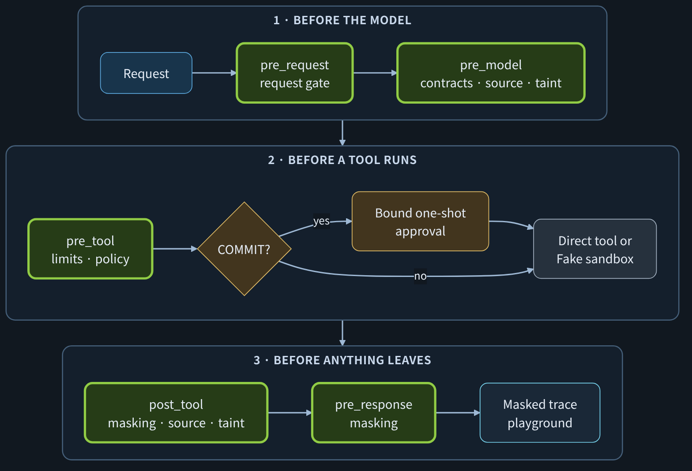

# Multi-Agent Orchestra — 계층형 슈퍼바이저 × LangSmith × NemoClaw

**한국어** · [English](README.md)

**총괄 → 팀장 → 실무자 에이전트 · 승인 기반 mock 결제 · NemoClaw 샌드박스**

[NemoClaw 흔한 문제](docs/NEMOCLAW_KNOWN_ISSUES.ko.md) · [설계서](docs/DESIGN.md) · [구현 노트](docs/IMPLEMENTATION.ko.md)

## NemoClaw 샌드박스 — 격리 점검 12 / 12

실설치 · WSL2 · NemoClaw v0.0.145 · OpenShell 0.0.116 · 2026-11-27 · [점검 스크립트](scripts/nemoclaw_isolation_check.py)

| # | 샌드박스 안에서 시도 | 막는 것 | 결과 |
|---|---|---|---|
| 1 | 인터넷에 직접 TCP 연결 | 네트워크 네임스페이스 | 시간 초과 |
| 2 | 목록에 없는 호스트로 HTTPS 터널 | 프록시 정책 | `403` |
| 3 | 목록에 없는 호스트로 평문 HTTP | 프록시 정책 | `403` |
| 4 | `/tmp` 쓰기 (대조군, 성공해야 함) | 허용 | 성공 |
| 5 | `/var/tmp` 쓰기 | Landlock | `EACCES` |
| 6 | `/dev/shm` 쓰기 | Landlock | `EACCES` |
| 7 | 워커 코드 변경 | 파일 권한 | `EACCES` |
| 8 | 정책 밖 파일 읽기 | Landlock | `EACCES` |
| 9 | root 로 실행 | 샌드박스 사용자 | uid `10001` |
| 10 | Linux capability 보유 | 부여 없음 | `0` |
| 11 | setuid 로 권한 상승 | `no_new_privs` | 켜짐 |
| 12 | 메모리에서 코드 실행 (`memfd_create`) | seccomp | `EPERM` |
| ⚠️ | `inference.local` 로 모델 호출 | **라우트가 비어 있을 뿐**: 설정하면 열림 | `503` |

## 1. 구현한 것

<p align="center">
  
</p>

## 2. 핵심 설계 결정 (결제는 mock)

| 기억할 점 | 방법 | 근거 |
|---|---|---|
| **청구 금액은 모델이 정하지 않는다** | 서버가 hold 합계를 계산 | [툴 정의](domains/payment/tools.py) |
| **승인 없이는 결제 없음** | 승인 필터를 꺼도 툴 래퍼가 장부를 확인 | [테스트](tests/test_simulation_golden.py) |
| **승인은 한 번만** | 인자·금액·사용자·만료에 묶임 | [테스트](tests/test_approval_binding.py) |
| **재개해도 두 번 결제하지 않는다** | 툴 노드는 재실행, capture 는 1번 | [테스트](tests/test_simulation_golden.py) |
| **네트워크 규칙은 코드에서 생성** | 툴 선언에서 생성, 와일드카드·중복 호스트는 실패 | [테스트](tests/test_policy.py), CI |
| **격리는 실측한다** | 실설치에서 점검 프로그램이 직접 시도 | [스크립트](scripts/nemoclaw_isolation_check.py) |

## 3. 분담과 남은 작업

| 영역 | 상태 |
|---|---|
| 계층 구조, 5단계 필터, 승인, mock 결제, 시나리오 9개 | ✅ 오프라인 |
| LangSmith 24개 기능 | ✅ 오프라인 · ⬜ 실제 서버 |
| NemoClaw 워커: 읽기 전용 툴, 시간 초과 응답, 격리 | ✅ 실설치 |
| 툴 시간 제한, 외부 중지 파일 | ✅ 오프라인 |
| 실제 LLM | ⬜ |
| egress 격리, 플러그인 도입 게이트, 차단 사유 코드 트레이스 | ✅ 오프라인 |
| 샌드박스 CPU·메모리 상한, 부하, 재시작, DNS·이웃 점검 | ✅ 오프라인 · ⬜ 실설치 |
| 샌드박스에 파일 올리기 | ⬜ |

## 구현 상세

<details>
<summary><b>저장소 구조</b></summary>

```
orchestra/                    도메인을 모르는 코어
  specs.py  org.py            선언형 조직도(OrgSpec), 구조 검증, 팬아웃 자동 분할(팀장당 선택지 ≤5)
  filters/                    FilterChain(5단계) + 내장 필터 + 툴 래퍼(승인/샌드박스/마지막 방어선)
  patterns/                   hierarchical_graph.py, hierarchical_tools.py  ← 계층형 + handoff + report/escalate
  models/                     ScriptedChatModel(LLM 없이 실제 그래프 실행), ModelFactory, 프라이버시 라우팅
  sandbox/                    SandboxRunner 계약, Fake 러너, nemoclaw/policy.py (egress preset 생성·검증)
  hitl.py runtime.py service.py simulation.py
domains/                      교체 가능한 도메인 팩
  travel/                     툴 17개, 예약은 hold(임시 점유)까지만
  payment/                    intent → 사용자 승인 → capture → 예약 확정, 상태기계·멱등성·한도·hold 만료
orgs/travel_payment.yaml      조직도 (총괄 1 + 팀장 4 + 실무자 10)
scenarios/*.yaml              시뮬레이션·검증 공용 시나리오 6개
nemoclaw/presets/*.yaml       ToolSpec 에서 생성된 egress 정책 (CI drift 검사)
```

**계층형 버그 수정**: `langgraph_supervisor` 가 멤버마다 거는 `member→supervisor` 고정 엣지 때문에, handoff 중 팀장이 끼어드는 문제를 발견·수정(`_detach_to_supervisor`).

</details>

<details>
<summary><b>실행 결과와 시나리오</b></summary>

**실행 결과 (`python -I examples/simulate_hierarchical.py`, 결제 구간 발췌)**

LLM 없이 라우팅만 스크립트로 고정하고, **실제 그래프·필터·승인·샌드박스 코드 경로**를 모두 탄다. 값은 mock.

```text
  [LLM #19] payment_lead: checkout_agent 호출 → 호출 transfer_to_checkout_agent
⑫ checkout_agent (실무자)
  [LLM #20] checkout_agent: 호출 create_payment_intent(hold_ids=['hold_0001'])
      [FILTER] pre_tool idempotency(create_payment_intent): modify — idempotency_key injected
      [FILTER] pre_tool side_effect_policy(create_payment_intent): route_sandbox — create_payment_intent runs in orchestra-payments
      [SANDBOX orchestra-payments] create_payment_intent ok (policy rev 1)
      · tool create_payment_intent(hold_ids=['hold_0001']) -> {'intent_id': 'pi_0001', 'amount': 180000, 'currency': 'KRW', 'status': 'created', 'hold_ids': ['hold_0001']}
  [LLM #21] checkout_agent: 호출 capture_payment(intent_id='pi_0001')
      [FILTER] pre_tool idempotency(capture_payment): modify — idempotency_key injected
      [FILTER] pre_tool amount_limit(capture_payment): require_approval — 결제 180,000원 사용자 승인 필요
      [FILTER] pre_tool side_effect_policy(capture_payment): require_approval — commit tool capture_payment needs user approval
      [HITL] 사용자 승인: 예
      [FILTER] pre_tool side_effect_policy(capture_payment): route_sandbox — capture_payment runs in orchestra-payments
      [SANDBOX orchestra-payments] capture_payment ok (policy rev 1)
      · tool capture_payment(intent_id='pi_0001') -> {'intent_id': 'pi_0001', 'status': 'captured', 'receipt_id': 'rcpt_0001', 'amount': 180000, 'currency': 'KRW'}
  [LLM #22] checkout_agent: 호출 confirm_booking(intent_id='pi_0001')
      [FILTER] pre_tool idempotency(confirm_booking): modify — idempotency_key injected
      [FILTER] pre_tool side_effect_policy(confirm_booking): route_sandbox — confirm_booking runs in orchestra-payments
      [SANDBOX orchestra-payments] confirm_booking ok (policy rev 1)
      · tool confirm_booking(intent_id='pi_0001') -> {'intent_id': 'pi_0001', 'status': 'confirmed', 'receipt_id': 'rcpt_0001', 'bookings': ['h1 standard 2026-11-28 1박 2명']}
  [LLM #23] checkout_agent: 결제 180,000원 완료, 영수증 rcpt_0001, 예약 확정
⑬ payment_lead (총괄/팀장)
  [LLM #24] payment_lead: 호출 report_to_parent(status='done', summary='결제 완료 및 예약 확정', artifacts={'receipt_id': 'rcpt_0001'})
      [REPORT payment_lead] done: 결제 완료 및 예약 확정
  [LLM #25] payment_lead: 결제·확정 완료 → 총괄에 보고
⑭ travel_director (총괄/팀장)
  [LLM #26] travel_director: 최종: 비(70%) → 실내 코스(고기국수 → 흑돼지), 제주시내 호텔 1박 hold → 180,000원 승인·결제·예약 확정 완료.

[interrupt #1] 180,000원을 Orchestra Travel (mock)에 결제할까요? (결제 후 환불 가능)  → 응답: 예

최종 답변:
  최종: 비(70%) → 실내 코스(고기국수 → 흑돼지), 제주시내 호텔 1박 hold → 180,000원 승인·결제·예약 확정 완료.

슈퍼바이저(총괄/팀장) LLM 호출 13회, 전체 LLM 호출 26회 (조직 깊이 2)

--- expect 검증 ---
PASS
```

전체 흐름: `travel_director → planning_lead → (weather_agent ⇢ restaurant_agent) → booking_lead → hotel_agent → payment_lead → checkout_agent`.

| 시나리오 | 검증 포인트 |
|---|---|
| `jeju_trip_payment` | 전체 계층 흐름 + 팀 내 handoff + HITL 승인 + 샌드박스 결제 + 예약 확정 |
| `jeju_payment_rejected` | 사용자가 거절 → capture 미실행, 확정 없음 |
| `payment_over_limit` | 스위트 2,400,000원 → `amount_limit` 차단, 승인 요청조차 없음 → 대안 제시 |
| `pii_bulk_blocked` | 게이트에서 차단, LLM 호출 0회 |
| `sandbox_egress_denied` | 결제 호스트가 정책에서 빠짐 → 샌드박스가 egress 거부 → 결제 미실행, 운영자 승인 안내 |
| `handoff_oversized` | 크기 상한을 초과한 위임 계약을 handoff 전에 차단 |

</details>

<details>
<summary><b>Playground · LangGraph Studio</b></summary>

`python examples/playground.py` 실행 후 `http://127.0.0.1:8765`를 엽니다.
첫 탭은 기존 레거시 데모입니다. 진단 탭 3개는 closed/Fake 스크립트 시나리오 실행 또는
C13 `--trace --json` 파일(2MB 이하) 가져오기를 지원합니다. CLI와 화면은 `export_simulation`을
공유합니다. 가져온 데이터는 검증·최소화·재마스킹 후 텍스트로 렌더링합니다. 승인 이력은
시나리오의 결정을 재생할 뿐 실제 결제를 승인하지 않습니다. 설계서 §9.4의 더 넓은 범위인
실시간 HITL 버튼·Org/Catalog 탭·hosted LangSmith 화면은 이번 C14에 구현하지 않았습니다.

`langgraph.json`은 `orchestra.service:studio_graph`를 선언합니다. Python 모듈 로드와
스크립트/Fake 그래프 빌드는 확인했습니다. 현재 환경에 `langgraph-cli`가 없어 실제
`langgraph dev` 실행과 Studio 화면은 미검증입니다.

</details>

## 부록 — 기존 골격 (supervisor / handoff / hybrid / hierarchical, LangSmith)

| 구조 | 방식 |
|---|---|
| A: supervisor | `supervisor ⇄ {weather, restaurant, hotel}`; 비 오면 실내 맛집 → 동선 근처 숙소 → 종합. 숙소 에이전트는 예약 툴 없음 |
| B: handoff | `weather ⇄ restaurant ⇄ hotel` 이 `transfer_to_*` 툴로 제어권 전달; `MemorySaver` 로 멀티턴 유지 |
| A+B: hybrid | `planner(A) → approval(interrupt) → hotel_booking`; 거절·변경은 `planner` 로 복귀; `draft_plan` 을 State 로 전달 |
| Hierarchical | 총괄 아래 팀장 슈퍼바이저를 두고 관리자당 선택지 3~5개 (지금은 `orchestra/` 가 대체) |

LangSmith 래퍼 모드 (`TRAVEL_SECURITY_MODE`): `off` / `masked` / `closed` — `closed` 는 트레이싱을 끄고, NemoClaw 에서는 LangSmith egress preset 자체를 만들지 않음 (물리 차단).
