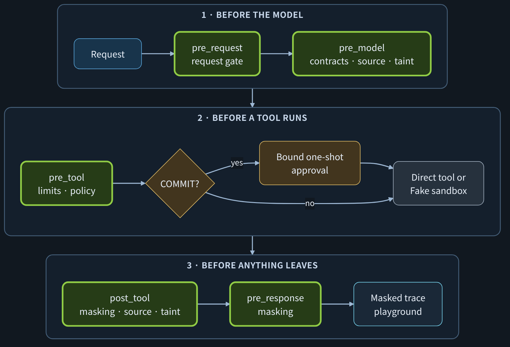

# Multi-Agent Orchestra — Hierarchical Supervisor × LangSmith × NemoClaw

[한국어](README.ko.md) · **English**

A design-and-implementation repo for organizing specialist agents (weather, restaurants, lodging, payment…) into a
**director → team lead → worker** hierarchy, with **swappable domain packs**, a **5-stage security filter chain**, and
**NemoClaw/OpenShell sandboxes** that isolate risky actions (payments, code execution).
Real compiled graphs run end to end from scenarios **without any LLM, network, or NemoClaw**.

**NemoClaw common problems** — [English](docs/NEMOCLAW_KNOWN_ISSUES.md) · [한국어](docs/NEMOCLAW_KNOWN_ISSUES.ko.md)

## NemoClaw worker sandbox — 12 isolation checks

**Result: 12 / 12 PASS** on one real install (WSL2, NemoClaw v0.0.145, OpenShell 0.0.116, 2026-11-27).
A probe runs inside the sandbox. Checks 1–8 and 12 *attempt* the action; 9–11 read the process identity and privilege flags.

| # | Check | When it applies | Enforced by | Observed |
|---|---|---|---|---|
| | **Network** | | | |
| 1 | `direct_tcp_refused` | Code opens a socket straight to the internet, bypassing the proxy | Sandbox network namespace | timeout |
| 2 | `proxy_tunnel_refused` | Code asks the sandbox proxy for an HTTPS tunnel (`CONNECT`) to an unlisted host | Proxy policy: no rule for the host | `403` |
| 3 | `proxy_http_refused` | Code sends plain HTTP to an unlisted host through the proxy | Proxy policy: no rule for the host | `403` |
| | **Files** | | | |
| 4 | `control_tmp_write` | Code writes a temporary file in `/tmp`. **Must succeed** (control case) | Allowed by the file policy | written, removed |
| 5 | `write_var_tmp_refused` | Code writes to `/var/tmp`, world-writable but not in the policy | Landlock | `EACCES` |
| 6 | `write_dev_shm_refused` | Code writes to shared memory `/dev/shm`, also not in the policy | Landlock | `EACCES` |
| 7 | `write_code_refused` | Code tries to change the worker's own program in `/opt/orchestra` | File permissions, read-only in policy | `EACCES` |
| 8 | `read_unlisted_refused` | Code opens a world-readable file outside the policy (`/var/lib/dpkg/status`) | Landlock | `EACCES` |
| | **Privileges** | | | |
| 9 | `not_root` | Every process the worker runs | Sandbox user | uid `10001` |
| 10 | `no_capabilities` | Code needs a Linux capability (admin-level kernel right) | Empty effective capability set | `CapEff` 0 |
| 11 | `no_new_privileges` | Code launches a setuid program to gain rights | Kernel `no_new_privs` flag | `1` |
| 12 | `memfd_refused` | Code creates an in-memory file to execute without touching disk (`memfd_create`) | Syscall filter (seccomp) | `EPERM` |

**Model route (checked separately): PASS, `no_route`.** OpenShell opens the tunnel to `inference.local` without any
network rule. No inference route was configured, so requests reached no model. **If a route is configured for the
sandbox's OpenShell workspace, sandbox code can call that model**; run the check again after any such change.

Not covered: CPU and memory limits, isolation between sandboxes, leaks through DNS. The result describes that install
and policy, not every NemoClaw version. Run it with
[`scripts/nemoclaw_isolation_check.py`](https://github.com/ai-agent-orchestrator/langsmith-multi-agent-nemoclaw/blob/21-nemoclaw-cli/scripts/nemoclaw_isolation_check.py);
the script and the worker sandbox are on branch
[`21-nemoclaw-cli`](https://github.com/ai-agent-orchestrator/langsmith-multi-agent-nemoclaw/tree/21-nemoclaw-cli).

## 1. What is implemented

<p align="center">
  
</p>

Any BLOCK stops the affected path. The sandbox in this flow is the local Fake runner. Normalization and taint rules
are defense in depth, not a complete prompt-injection solution.

## 2. Key design decisions

| Decision | What it guarantees |
|---|---|
| **Swappable domain packs** | Tools, agents, filters and scenarios live in `domains/*`; the core never imports a domain (test-enforced) |
| **The server computes the amount** | The LLM never decides what is charged: the total comes from the holds |
| **Three approval layers, one-shot** | No approval-ledger entry, no capture, even with all filters disabled; no answer means denial |
| **Safe interrupt / resume** | Tool nodes re-run on resume, yet payment is captured exactly once (pinned by a test) |
| **Fail closed** | A filter exception becomes BLOCK; sandbox mode without a runner aborts |
| **Egress policy generated from declarations** | Duplicate host:port, wildcards, `access: full` and inference hosts are rejected; `closed` mode drops the LangSmith preset |

## 3. Division of work and what remains

| Area | Status |
|---|---|
| Specs/org chart/fan-out, filter chain + built-ins, tool wrapper, HITL, ScriptedChatModel | ✅ done |
| Hierarchical graph/tools, service, travel + payment packs, simulation + 6 scenarios | ✅ offline |
| NemoClaw policy generation/validation/drift/fail-closed, fake sandbox | ✅ done (real NemoClaw: see the last row) |
| Packaging, legacy shims, immutable vendoring, frontmatter and 14-plugin catalog | ✅ C1–C5 |
| hookify rules → existing filter stages | ✅ C9 |
| 24-feature LangSmith map + offline `showcase` CLI | ✅ C11 offline; hosted/API+UI paths unverified |
| CLI org/pattern/local trace options | ✅ C13 |
| Claude tool mapping / `claude_dev` / adapters / additional domain scenarios | ⬜ C6–C8, C10; R4 + tool-count policy gate |
| v1 backend (`langchain.agents.create_agent`), scenario parity | ✅ C15 (scripted models) |
| Source-labelled contracts, approval binding, capability checks, inspection normalization/taint | ✅ C16–C19; rule-based defense in depth |
| Memory / masked HMAC SQLite ledgers, local mock atomicity | ✅ C22; full workflow restart is not supported |
| Playground trace / filter / approval-history tabs; Studio entry declaration | ✅ C14; `langgraph dev` unverified (CLI not installed) |
| Real NemoClaw worker sandbox (branch `21-nemoclaw-cli`) | 🟡 isolation checks 12/12 on one install; ⬜ CPU/memory limits, load, recovery after restart |

## Implementation details

<details>
<summary><b>Contracts, backends, LangSmith, catalog and repository layout</b></summary>

Message contracts require a source label (`user/tool/agent/system`) and bounded
fields/nesting. The host maps explicit SDK roles to source labels; external
TaskBrief/TeamReport DTOs cannot omit the label. Pre-model and handoff validation
fail closed. Agent/tool text is JSON-framed as data with escaped delimiters;
this is defense in depth and cannot guarantee semantic injection resistance.
The `handoff_oversized` scenario verifies rejection on both backends.


Agent construction supports `prebuilt` (the compatibility default) and `v1`.
Install `pip install -e ".[agent-v1]"` and set `ORCHESTRA_AGENT_BACKEND=v1` to use
`langchain.agents.create_agent` for both workers and team supervisors. The builder
also accepts `backend="v1"` explicitly. Development installs include both backends
so parity tests run rather than skip. Missing v1 dependencies produce a clear error.

```powershell
$env:ORCHESTRA_AGENT_BACKEND = 'v1'
python -I examples/simulate_hierarchical.py --mode graph --sandbox fake --security-mode closed
```

Both backends share tool wrappers, approval ledgers, model filters and checkpoint
handling. V1 supports synchronous/asynchronous team handoffs without deprecated
agent factories. Compatibility `prebuilt` and legacy non-hierarchical builders
still emit their existing deprecation warnings. Real provider models remain unverified.

LangSmith observation is available under `orchestra.observability`; the original
`travel_planner.observability` and `monitoring` imports remain compatibility shims.
Run `python -m orchestra.observability.showcase all --offline` to generate a local
24-feature manifest and session report. Real SDK traces terminate at a loopback
receiver; remote mutations are explicitly recorded offline. The payment safety
gate fails CI on an executed COMMIT without matching approval evidence.
See [LangSmith setup and verified limits](docs/langsmith-ui-setup.md) for service
hook integration, Prompt Hub fallbacks, UI procedures and unsupported capabilities.

Third-party snapshots are pinned in `third_party/LOCK.json` with per-file SHA-256
hashes. Run `python scripts/sync_third_party.py --check` without network access to
check integrity. To update a snapshot, use only this script:

```bash
python scripts/sync_third_party.py --component claude_plugins --source /path/to/claude-10-plugin-for-multi-agent --commit <40-character-sha>
python scripts/sync_third_party.py --component multi_agent_module_lib --source /path/to/multi-agent-module-lib --commit <40-character-sha>
pytest -q tests/third_party
```

`--source` also accepts the component's allowlisted HTTPS Git URL. Source trees
are never modified; selected Git blobs are copied unchanged. See
`third_party/NOTICE.md`: plugin Apache licenses are retained, while the pinned
module-lib examples have no upstream LICENSE and need license clarification.
Vendored hooks are catalog data and are never executed during synchronization.

Inspect the read-only plugin catalog without LLMs or external services:

```bash
python -m orchestra.catalog list
python -m orchestra.catalog show pr-review-toolkit/code-reviewer
python -m orchestra.catalog validate
```

The pinned snapshot contains 14 plugins, 16 original agents, 12 skills and 12
commands. Plugin directory names define stable namespaces even when the manifest
uses a renamed alias. `CLAUDE_PLUGINS_DIR` or `--root` selects the input directory.
The original `silent-failure-hunter.md` has invalid YAML; validation reports its
legacy-parser fallback as a warning. Hooks and declared tool names are metadata.
No plugin commands, hooks, file writes or shell tools are executed by this catalog.

`SkillLoader.index()` exposes only skill names and descriptions. `make_skill_tools`
provides READ-only `load_skill(name)` and `load_skill_reference(name, file)` tools
for registered files. Responses pass through PII/PCI masking and are capped at
`ORCHESTRA_SKILL_MAX_CHARS` (default and hard ceiling: 20000); long responses
include a contents summary and prefix. References cannot select arbitrary files.

```
orchestra/                    domain-agnostic core
  specs.py  org.py            declarative OrgSpec, validation, automatic fan-out splitting (≤5 options per lead)
  filters/                    FilterChain (5 stages) + built-ins + tool wrapper (approval/sandbox/last-line defense)
  patterns/                   hierarchical_graph.py, hierarchical_tools.py  <- hierarchy + handoff + report/escalate
  models/                     ScriptedChatModel (run real graphs without an LLM), ModelFactory, privacy routing
  sandbox/                    SandboxRunner contract, fake runner, nemoclaw/policy.py (egress preset generation/validation)
  hitl.py runtime.py service.py simulation.py
domains/                      swappable domain packs
  travel/                     17 tools; bookings stop at a temporary hold
  payment/                    intent -> user approval -> capture -> confirm; state machine, idempotency, limits, hold expiry
orgs/travel_payment.yaml      org chart (1 director + 4 leads + 10 workers)
scenarios/*.yaml              6 scenarios shared by simulation and tests
nemoclaw/presets/*.yaml       egress policies generated from ToolSpecs (CI drift check)
```

**Hierarchy bug fixed:** `langgraph_supervisor` adds a static `member->supervisor` edge per member, which woke the team lead mid-handoff; fixed with `_detach_to_supervisor`.

</details>

<details>
<summary><b>Sample run and scenarios</b></summary>

**Sample run (`python -I examples/simulate_hierarchical.py`, payment segment)**

Only routing is scripted; the **real graph, filter, approval, and sandbox code paths** all execute. Values are mock.

```text
  [LLM #19] payment_lead: checkout_agent 호출 → 호출 transfer_to_checkout_agent
⑫ checkout_agent (실무자)
  [LLM #20] checkout_agent: 호출 create_payment_intent(hold_ids=['hold_0001'])
      [FILTER] pre_tool idempotency(create_payment_intent): modify — idempotency_key injected
      [FILTER] pre_tool side_effect_policy(create_payment_intent): route_sandbox — create_payment_intent runs in orchestra-payments
      [SANDBOX orchestra-payments] create_payment_intent ok (policy rev 1)
      · tool create_payment_intent(hold_ids=['hold_0001']) -> {'intent_id': 'pi_0001', 'amount': 180000, 'currency': 'KRW', 'status': 'created', 'hold_ids': ['hold_0001']}
  [LLM #21] checkout_agent: 호출 capture_payment(intent_id='pi_0001')
      [FILTER] pre_tool idempotency(capture_payment): modify — idempotency_key injected
      [FILTER] pre_tool amount_limit(capture_payment): require_approval — 결제 180,000원 사용자 승인 필요
      [FILTER] pre_tool side_effect_policy(capture_payment): require_approval — commit tool capture_payment needs user approval
      [HITL] 사용자 승인: 예
      [FILTER] pre_tool side_effect_policy(capture_payment): route_sandbox — capture_payment runs in orchestra-payments
      [SANDBOX orchestra-payments] capture_payment ok (policy rev 1)
      · tool capture_payment(intent_id='pi_0001') -> {'intent_id': 'pi_0001', 'status': 'captured', 'receipt_id': 'rcpt_0001', 'amount': 180000, 'currency': 'KRW'}
  [LLM #22] checkout_agent: 호출 confirm_booking(intent_id='pi_0001')
      [FILTER] pre_tool idempotency(confirm_booking): modify — idempotency_key injected
      [FILTER] pre_tool side_effect_policy(confirm_booking): route_sandbox — confirm_booking runs in orchestra-payments
      [SANDBOX orchestra-payments] confirm_booking ok (policy rev 1)
      · tool confirm_booking(intent_id='pi_0001') -> {'intent_id': 'pi_0001', 'status': 'confirmed', 'receipt_id': 'rcpt_0001', 'bookings': ['h1 standard 2026-11-28 1박 2명']}
  [LLM #23] checkout_agent: 결제 180,000원 완료, 영수증 rcpt_0001, 예약 확정
⑬ payment_lead (총괄/팀장)
  [LLM #24] payment_lead: 호출 report_to_parent(status='done', summary='결제 완료 및 예약 확정', artifacts={'receipt_id': 'rcpt_0001'})
      [REPORT payment_lead] done: 결제 완료 및 예약 확정
  [LLM #25] payment_lead: 결제·확정 완료 → 총괄에 보고
⑭ travel_director (총괄/팀장)
  [LLM #26] travel_director: 최종: 비(70%) → 실내 코스(고기국수 → 흑돼지), 제주시내 호텔 1박 hold → 180,000원 승인·결제·예약 확정 완료.

[interrupt #1] 180,000원을 Orchestra Travel (mock)에 결제할까요? (결제 후 환불 가능)  → 응답: 예

최종 답변:
  최종: 비(70%) → 실내 코스(고기국수 → 흑돼지), 제주시내 호텔 1박 hold → 180,000원 승인·결제·예약 확정 완료.

슈퍼바이저(총괄/팀장) LLM 호출 13회, 전체 LLM 호출 26회 (조직 깊이 2)

--- expect 검증 ---
PASS
```

Full flow: `travel_director -> planning_lead -> (weather_agent -> restaurant_agent) -> booking_lead -> hotel_agent -> payment_lead -> checkout_agent`.

| Scenario | What it verifies |
|---|---|
| `jeju_trip_payment` | Full hierarchy + in-team handoff + HITL approval + sandboxed payment + booking confirmation |
| `jeju_payment_rejected` | User declines -> no capture, no confirmation |
| `payment_over_limit` | 2,400,000 KRW suite -> blocked by `amount_limit`, no approval request, alternatives offered |
| `pii_bulk_blocked` | Blocked at the gate, zero LLM calls |
| `sandbox_egress_denied` | Payment host missing from policy -> sandbox denies egress -> no payment, operator-approval notice |
| `handoff_oversized` | Oversized delegation contract is blocked before handoff |

</details>

<details>
<summary><b>Playground and LangGraph Studio</b></summary>

Run `python examples/playground.py` and open `http://127.0.0.1:8765`.
The legacy demo remains the first tab. The three diagnostic tabs can run closed/Fake
scripted scenarios or import a C13 `--trace --json` file (up to 2 MB). CLI and viewer
share `export_simulation`; imports are validated, minimized and masked again, and
rendered as text. Approval history replays fixture decisions; it does not approve
live payments. Live HITL controls, Org/Catalog tabs and hosted LangSmith views from
the broader §9.4 design are not implemented by this C14 scope.

`langgraph.json` declares `orchestra.service:studio_graph`. The symbol is importable
and builds a scripted/Fake graph locally. `langgraph-cli` is absent here, so running
`langgraph dev` and viewing Studio remain unverified.

</details>

## NemoClaw in this repo

This repo covers the part of NemoClaw you can **see and run offline**: `ToolSpec` egress declarations -> preset generation, validation and drift check (`scripts/gen_nemoclaw_presets.py`), the security-mode <-> preset mapping (`closed` removes the LangSmith egress preset entirely), and a fake sandbox that makes the `sandbox_egress_denied` scenario show the multi-agent -> LangSmith -> NemoClaw flow end to end.

**Not covered on this branch:** executing inside a real sandbox. The worker sandbox work is on branch [`21-nemoclaw-cli`](https://github.com/ai-agent-orchestrator/langsmith-multi-agent-nemoclaw/tree/21-nemoclaw-cli); see the isolation checks above. CLI and policy schemas vary by NemoClaw version.

---

# Appendix — Original skeleton (supervisor / handoff / hybrid / hierarchical, LangSmith)

The earlier skeleton (`travel_planner/`) is kept as is (its 14 original tests still pass); a backward-compatible shim onto `orchestra/` is Codex task C2.
The detailed legacy write-up (structure diagrams, LangSmith wrapper, security modes, bottleneck report, playground) is in the Korean README: [`README.ko.md`](README.ko.md#부록--기존-골격-supervisor--handoff--hybrid--hierarchical-langsmith-연동).

Quick summary of the legacy structures:

| Structure | Idea |
|---|---|
| A: supervisor | `supervisor <-> {weather, restaurant, hotel}`; rain -> indoor restaurants -> hotel near the route -> summary; the hotel agent has no booking tool |
| B: handoff | `weather <-> restaurant <-> hotel` pass control via `transfer_to_*` tools; `MemorySaver` keeps multi-turn state |
| A+B: hybrid | `planner(A) -> approval(interrupt) -> hotel_booking`; reject/change returns to `planner`; `draft_plan` is passed as state |
| Hierarchical | Team-lead supervisors under a director, keeping each manager to 3–5 options (now superseded by `orchestra/`) |

LangSmith wrapper modes (`TRAVEL_SECURITY_MODE`): `off` / `masked` / `closed` — in `closed`, tracing is disabled and, under NemoClaw, the LangSmith egress preset is not generated at all (physical block).

Approval records bind the full canonical arguments, caller identity, server-derived
amount, expiry and request/thread ID with a full SHA-256 key. Set
`ORCHESTRA_APPROVAL_TTL_SECONDS` (default 300); supply the authenticated caller as
`user_id=` to both OrchestraService.ask and resume. Legacy calls default to
`anonymous`; this is compatibility, not authentication. Checkpointed approval
payloads preserve the original deadline across interrupt re-execution. The ledger
atomically claims the grant before execution. Signature fields are reserved only;
no signing, persistence, or hash-chain audit was added.

### Delegation capabilities (C18)

`TeamSpec.capabilities` accepts optional `tools`, `domains`, and `sandboxes` lists.
An explicit list is an upper bound: every descendant grant must fit inside it.
Omitted dimensions derive from the subtree's actual grants; they are not wildcards.
Empty lists grant nothing. Agent tools remain restricted to `AgentSpec.tools`.
After domain resolution, sandbox ownership comes from registered pack metadata;
foreign-domain sandbox tools and unknown grants fail closed before graph construction.
Generated fanout leads inherit the same ancestor bounds. Host-defined agents without
pack metadata have no domain or sandbox authority. These checks validate graph
configuration; OS sandbox startup/policy attestation remains the separate runner work.

### Inspection normalization and tool provenance (C19)

The request gate checks a separate inspection copy: NFKC, decomposition/removal
of combining marks and zero-width formatters, whitespace folding, and 1→i / 0→o.
Business payloads, amounts, dates and original user messages are never rewritten.
The legacy security gate uses the same inspection function.

Successful post-tool data is exposed as `{"source":"tool","data": ...}`; this
host-owned outer label overrides any source claim inside the returned data.
The existing pre-model/handoff paths retain tool roles and reject recognized
instruction patterns even through replayed data frames. Nested tool-labelled
instructions cannot be passed as delegation or COMMIT data. Once a tool result
matches the shared gate patterns, its raw text is replaced with a generic blocked
marker and that thread is conservatively quarantined: delegation and COMMIT are
blocked before approval or execution. Normal model continuation also stops on
the marker. Quarantine is scoped by LangGraph configuration and is not cleared by
user approval; use a new thread after investigation. State is process-memory only.

This is **defense in depth**, not a complete prompt-injection solution or semantic
taint tracking. Unrecognized paraphrases, other encodings, and model reasoning
cannot be proven safe by these rules. A recognized quoted example can also trigger
a conservative block. Source labels attest transport, not truth. Scanner, red-team
framework, audit signatures and real sandbox runner remain separate work.

### Simulation CLI (C13)

```bash
python -I examples/simulate_hierarchical.py --org orgs/travel_payment.yaml --pattern tools --trace --json out/sim/trace.json
```

`--pattern graph` is the default and retains the previous behavior. `tools` is a
thin entry point in the control-tool factory module and calls the same safe graph
builder; it is not another orchestration or model backend. An explicit `--org`
replaces the scenario organization without modifying the scenario file. A missing
path or directory exits with status 2 and one diagnostic line before graph execution.
`--mode print|graph` still controls presentation only; both execute the real graph.

`--trace` collects local filter decisions (including ALLOW), approval requests and
results, sandbox routes/results, and blocks. Each `[TRACE]` line is one JSON record
with a monotonically ordered event `seq`. Newlines inside fields are escaped.
`--json` additionally includes the same `trace` array, using existing event order
and deduplication. Trace console text and JSON exports always pass through masking,
even with `--security-mode off`. Trace records whitelist diagnostic fields and omit
approval bindings/full tool args. This option does not enable LangSmith transmission.
Without it, the existing narrative/JSON shape and event capture behavior are retained.

### Ledger persistence (C22)

The default `LedgerStore` is isolated process memory and needs no key or file.
For SQLite, set `ORCHESTRA_LEDGER=sqlite:///C:/private/orchestra/ledger.db`
with an explicit path in an existing directory, and set
`ORCHESTRA_LEDGER_HMAC_KEY` to a random secret of at least 32 UTF-8 bytes in the
environment. Missing/short keys reject startup before opening the database.
`ORCHESTRA_LEDGER_KEY_ID` is an optional public rotation label; when omitted,
a non-secret HMAC-derived identifier is used. No default database path or secret
is provided. Schema version 1 is recorded in SQLite and approval rows; unknown
future versions fail closed. Tests create databases only under pytest `tmp_path`.

The original C17 `ApprovalRecord` and canonical arguments stay in memory. SQLite
stores a domain-separated, full-length HMAC-SHA256 binding over the entire original
C17 tuple, a separate HMAC of the user, a key ID, expiry, consumption flag and
masked display. Display omits argument/user/request contents and may show amount.
Execution recomputes the HMAC from a valid transient record, including the original
expiry and request ID; a new deadline never revives an old authorization. Expired
records are invalid on read and `store.cleanup_expired(now)` deletes them.

`ApprovalLedger`, `EventLog` and the local `MockPaymentProvider` share one store.
`BEGIN IMMEDIATE` plus a conditional consume UPDATE prevents two connections from
claiming the same grant. Consumption, mock payment state, and the keyed idempotency
entry commit together. Failed mock-state writes roll back all three. Original
arguments, unkeyed approval hashes, and raw binding payloads are omitted from
persistent events. Payment safety evaluation correlates host-generated HMAC
references after this redaction. A stable `EventLog(store=store, scope="app")`
reloads masked events and deduplicates across instances; use separate scopes for
independent runs. Default runtime scope is `runtime`.

Key rotation: stop old writers, let outstanding approvals expire (or deny them),
then deploy a new environment key/key ID together. New-key instances cannot consume
or overwrite old-key approvals; retain their masked metadata as read-only until
expiry, then clean it up. Old idempotency indexes are key-specific: do not blindly
retry old requests across key epochs. Inspect recorded receipts and reconcile
pending requests before enabling new work; no automatic re-keying or recovery of
raw inputs is implemented. Keep old secrets out of the database and version control.

One masked `append_event` hook is available for future signature/chain integration;
its default is a no-op. No signature or hash chain is implemented. These guarantees
cover the local mock/Fake path. SQLite COMMIT rejects nonparticipating payment
providers and remote sandbox transports. Graph checkpoints, holds, model queues,
and actual payment-provider effects are not made durable or transactionally coupled
by this feature; full workflow restart/resume and real NemoClaw remain unverified.
`Memory` mode retains C17 consumption on execution failure; only participating SQLite mock operations roll back authorization together with payment state.
