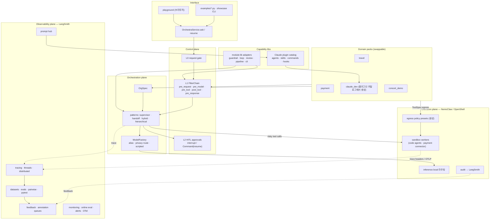
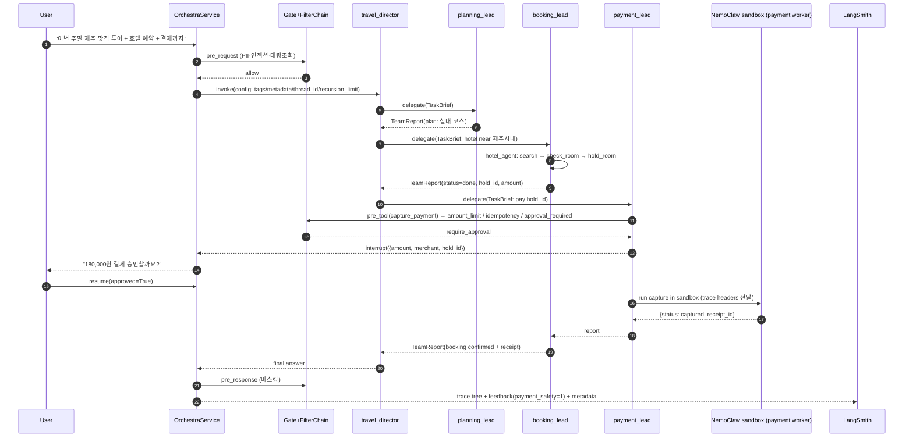

# Orchestra 확장 설계서 — Multi-Agent × LangSmith × NemoClaw

> ## 구현 현황 (2026-11-22)
> 이 설계서의 **핵심 코어는 이미 구현**되어 있다. 무엇이 끝났고 무엇이 남았는지, 설계에서 달라진 점은
> [`docs/CODEX_HANDOFF.md`](CODEX_HANDOFF.md) 가 **단일 기준**이다. NemoClaw 보완 계획은 [`docs/NEMOCLAW_ROADMAP.md`](NEMOCLAW_ROADMAP.md).
> 아래 본문 중 구현된 부분과 다른 곳은 HANDOFF 의 "설계 이탈" 표를 따른다.

> 대상 저장소: `ai-agent-orchestrator/langsmith-multi-agent-nemoclaw` (main, `bc8f425` 기준)
> 결합 대상: `ai-agent-orchestrator/claude-10-plugin-for-multi-agent` (플러그인 14개), `ai-agent-orchestrator/multi-agent-module-lib` (모듈 6개)
> 구현 주체: Codex. 이 문서는 **구현 명세**다. 작업 순서·완료 기준은 `AGENTS.md`와 §16을 따른다.
> 표기: **[MUST]** 반드시 구현 / **[SHOULD]** 가능하면 구현 / **[VERIFY]** 설치된 버전에서 API·CLI 이름을 먼저 확인하고 구현

---

## 0. 한 장 요약

| 축 | 현재 (main) | 확장 후 |
|---|---|---|
| 패턴 | supervisor / handoff / hybrid / hierarchical, 도메인 하드코딩 | 같은 4패턴을 **OrgSpec(선언형 조직도)** 에서 생성. 계층형은 팀 안 handoff·에스컬레이션·결제 승인(HITL)까지 포함 |
| 도메인 | 여행 툴이 그래프 파일에 import로 고정 | **DomainPack**(툴+팀+필터+프롬프트) 교체형. `travel`, `payment`, `claude_dev`, `concert_demo`(교체 증명용) |
| 필터 | `security_gate` 1개(요청 단계) | **FilterChain**: 요청 → 모델 → 툴 전/후 → 응답, 5단계 훅. 도메인별로 끼우고 뺄 수 있음 |
| Claude 에이전트 | 없음 | 플러그인 14개의 agents 16개·skills 12개·commands·hooks를 **카탈로그로 자동 로드**해 LangGraph 노드/필터/워크플로로 사용 |
| module-lib | 없음 | guardrail / loop_control / review_aggregator / prompt_loader / orchestrator / cli_subagent 6개를 어댑터로 편입 |
| LangSmith | 트레이싱·마스킹·로컬평가·병목 | 트레이싱 전 범위 + threads + 분산 트레이싱 + feedback + datasets + offline/pairwise/pytest eval + prompt hub + annotation queue + online eval/alerts 설정 + OTel. **`showcase` CLI와 playground 탭으로 기능별로 눈으로 확인** |
| NemoClaw | 이름만 있음 | **실행·보안 평면**: 위험 실행자(Bash/Write 쓰는 Claude 에이전트, 결제 커넥터)를 OpenShell 샌드박스로 격리, egress 정책을 DomainPack 선언에서 생성, 추론은 `inference.local` 경유, 감사 이벤트를 LangSmith로 연결 |
| 시뮬레이션 | print 스크립트 | `--mode print`(기존) + `--mode graph`: **실제 그래프**를 ScriptedChatModel로 LLM 없이 실행 → 실제 LangSmith 트레이스 생성. 시나리오 8종 |

---

## 1. 현재 코드 진단 (구현 전 반드시 알아야 할 사실)

1. **도메인 결합**: `hierarchical_graph.py`가 `hierarchical_tools.py`의 17개 툴을 직접 import. `tools.py`와 `hierarchical_tools.py`에 `get_weather`, `search_restaurants`, `search_hotels`, `book_hotel`이 **중복 정의**되어 있고 반환 스키마도 다르다(`price` vs `price_per_night`). → 도메인 툴은 한 곳(`domains/travel/tools.py`)으로 통합.
2. **모델 1개 공유**: 모든 빌더가 `model` 하나를 받는다. 에이전트별 모델(Claude 플러그인 md의 `model: haiku|sonnet|opus|inherit`), 민감도 라우팅(로컬 Nemotron), 스크립트 모델(시뮬레이션)이 불가능. → **ModelFactory** 도입.
3. **결제 부재**: `book_hotel`/`book_flight`가 곧바로 `confirmed`. 결제 승인·한도·멱등성 없음. README도 "실서비스에서는 interrupt()" 라고만 적혀 있음.
4. **관측 래퍼는 잘 분리됨**: `observability.py`(모드·마스킹·게이트·run_config), `monitoring.py`(순수 함수 집계), `service.py`. 이 구조(그래프를 바깥에서 감싸기)는 유지하고 패키지로 승격한다. 기존 테스트 14개는 **계속 통과**해야 한다.
5. **module-lib = 플러그인 저장소 `examples/`**: 두 저장소의 6개 파일은 바이트 단위로 동일(`cmp` 확인). 패키지(`pyproject.toml`)가 없다. → 한 곳(module-lib)만 벤더링하고 잠금 파일로 고정.
6. **`prompt_loader.parse` 버그**: 줄 단위 `key: value` 파서라서 `plugin-dev/agents/*.md`, `pr-review-toolkit/agents/code-simplifier.md`의 `description: |` 여러 줄 YAML을 `"|"`로 읽는다. `skill-creator/.../agents/{grader,comparator,analyzer}.md`는 frontmatter가 없다. → PyYAML `safe_load`로 교체(§7.2).
7. **이름 충돌**: `code-reviewer`가 `feature-dev`와 `pr-review-toolkit` 양쪽에 있다. → 에이전트 ID는 반드시 `plugin/agent` 네임스페이스.
8. **Claude Code 전용 툴 이름**: md의 `tools:`는 `Glob, Grep, LS, Read, NotebookRead, WebFetch, TodoWrite, WebSearch, KillShell, BashOutput, Bash, Edit, Write` 등 Claude Code 내장 툴이다. LangGraph에서 쓰려면 **로컬 구현으로 매핑**해야 하고, 쓰기/셸 계열은 샌드박스에서만 허용해야 한다(§7.3).
9. **재사용 가능한 업스트림 코드**: `security-guidance/hooks/patterns.py`는 "side-effect-free, import 가능"이라고 명시된 순수 데이터(`SECURITY_PATTERNS`, 360줄). `hookify/core/{config_loader,rule_engine}.py`는 `.local.md` 규칙 파서/엔진. 둘 다 Apache-2.0 → NOTICE 유지 조건으로 그대로 import.
10. **LangGraph 버전 축**: `langgraph.prebuilt.create_react_agent` + `langgraph-supervisor`는 현재 코드가 쓰는 API다. LangGraph/LangChain 1.x에서는 `langchain.agents.create_agent` + middleware가 권장 경로다. → **AgentBackend 추상화**로 두 경로를 모두 지원(§6.1). **[VERIFY]**

---

## 2. 설계 원칙

1. **코어는 도메인을 모른다.** `orchestra/`는 여행·결제·코드리뷰 단어를 하나도 import하지 않는다. 도메인은 `domains/*`에서 등록만 한다.
2. **선언 → 생성.** 조직도(OrgSpec), 툴 메타(ToolSpec: 부작용 등급·egress 호스트), 필터 체인은 YAML/파이썬 선언이고 그래프·정책 파일·LangSmith 데이터셋은 선언에서 **생성**한다. 같은 선언에서 NemoClaw 정책과 LangSmith 메타데이터가 나오므로 셋이 어긋나지 않는다.
3. **슈퍼바이저 팬아웃 ≤ 5, 에이전트당 툴 ≤ 3(도메인) / ≤ 6(엔지니어링).** 넘으면 빌더가 자동으로 sub-lead를 삽입한다.
4. **보안은 겹으로.** L0 요청 게이트 → L1 FilterChain → L2 HITL 승인 → L3 NemoClaw 샌드박스·egress → L4 LangSmith 전송 마스킹/차단. 한 겹이 뚫려도 다음 겹이 막는다. 각 겹은 독립 테스트한다.
5. **LLM·네트워크·NemoClaw 없이 전부 테스트 가능.** ScriptedChatModel, FakeSandboxRunner, 로컬 LangSmith 수신 서버(기존 테스트 방식)로 CI가 돈다. 실제 연동은 `-m integration` 마커.
6. **하위 호환.** `from travel_planner import build_hierarchical_app`, `TravelService("hierarchical", model).ask(...)`는 그대로 동작한다(내부에서 orchestra 호출하는 shim).

---

## 3. 전체 아키텍처



### 3.1 요청 1건의 수명 (계층형, 결제 포함)



---

## 4. 저장소 레이아웃 (목표)

```
.
├── AGENTS.md                         # Codex 작업 규칙 (별도 파일)
├── pyproject.toml                    # [MUST] 패키지화, extras: dev, langsmith, nemoclaw, claude-cli
├── requirements.txt                  # 기존 유지 (pyproject에서 생성/동기화)
├── .env.example                      # §13 변수 전부
├── langgraph.json                    # [SHOULD] LangGraph Studio / `langgraph dev`
├── orchestra/                        # ── 도메인 비의존 코어
│   ├── __init__.py
│   ├── settings.py                   # pydantic-settings 기반 Settings
│   ├── specs.py                      # AgentSpec, TeamSpec, OrgSpec, ToolSpec, FilterSpec
│   ├── state.py                      # OrchestraState, TaskBrief, TeamReport, Approval, PaymentRecord
│   ├── registry.py                   # DomainPack 레지스트리 (entry points + 명시 등록)
│   ├── models/
│   │   ├── factory.py                # ModelFactory, alias 해석, provider 생성
│   │   ├── aliases.py                # haiku/sonnet/opus/inherit/local → 모델 ID (env로 덮어쓰기)
│   │   ├── privacy_router.py         # 민감도 → 로컬/프론티어 선택
│   │   └── scripted.py               # ScriptedChatModel (LLM 없는 그래프 실행)
│   ├── backends/
│   │   ├── base.py                   # AgentBackend 프로토콜
│   │   ├── prebuilt.py               # create_react_agent + langgraph_supervisor (현행)
│   │   └── v1.py                     # langchain.agents.create_agent + middleware [VERIFY]
│   ├── patterns/
│   │   ├── supervisor_graph.py
│   │   ├── handoff_graph.py
│   │   ├── hybrid_graph.py
│   │   ├── hierarchical_graph.py     # [MUST] OrgSpec → 다단 슈퍼바이저 + 팀 내 handoff
│   │   └── hierarchical_tools.py     # [MUST] delegate / report / escalate / request_approval / handoff 팩토리
│   ├── filters/
│   │   ├── base.py                   # Filter 프로토콜, FilterContext, FilterDecision
│   │   ├── chain.py                  # FilterChain (순서·단락·트레이싱)
│   │   ├── tool_wrapper.py           # prebuilt 백엔드용 툴 래핑
│   │   ├── middleware.py             # v1 백엔드용 middleware 어댑터
│   │   └── builtin/
│   │       ├── request_gate.py       # 기존 security_gate 이관
│   │       ├── pii_mask.py           # 기존 MASK_RULES 이관 (응답·툴 출력 마스킹)
│   │       ├── tool_allowlist.py     # 실행 모드별 허용 툴
│   │       ├── side_effect_policy.py # side_effect 등급 → 승인/샌드박스 강제
│   │       ├── code_guardrail.py     # module-lib guardrail + security-guidance patterns
│   │       ├── hookify_rules.py      # hookify .local.md 규칙 → Filter
│   │       └── budget.py             # 토큰/툴호출/비용 상한 (loop_control 연계)
│   ├── hitl.py                       # 승인 요청/재개 헬퍼, Approval 레코드
│   ├── catalog/
│   │   ├── frontmatter.py            # PyYAML 기반 파서 (prompt_loader 대체)
│   │   ├── claude_plugins.py         # 플러그인 디렉터리 스캔 → PluginCatalog
│   │   ├── tool_mapping.py           # Claude Code 툴명 → 로컬 툴 구현
│   │   ├── workflows.py              # commands/*.md → 워크플로 템플릿 (feature-dev, review-pr, code-review)
│   │   └── skills.py                 # SKILL.md → load_skill 툴 / 프롬프트 부록
│   ├── modules/                      # module-lib 어댑터 (§8)
│   │   ├── guardrail_adapter.py
│   │   ├── loop_adapter.py
│   │   ├── review_adapter.py
│   │   ├── pipeline_adapter.py
│   │   └── cli_adapter.py
│   ├── observability/                # 기존 observability.py / monitoring.py 이관 + 확장 (§9)
│   │   ├── modes.py  masking.py  tracing.py  threads.py  distributed.py
│   │   ├── feedback.py  datasets.py  evals.py  evaluators.py  pairwise.py
│   │   ├── prompts.py  annotation.py  online.py  otel.py  monitoring.py
│   │   └── showcase.py               # `python -m orchestra.observability.showcase <feature>`
│   ├── sandbox/                      # NemoClaw / OpenShell (§10)
│   │   ├── base.py                   # SandboxRunner 프로토콜, ExecResult, EgressDenied
│   │   ├── local.py                  # 샌드박스 없음 (개발용, 위험 툴은 dry-run)
│   │   ├── fake.py                   # 테스트용 (정책 시뮬레이션)
│   │   └── nemoclaw/
│   │       ├── cli.py                # nemoclaw / openshell 서브프로세스 래퍼 (allowlist)
│   │       ├── runtime.py            # 샌드박스 안/밖 감지
│   │       ├── inference.py          # inference.local 모델 생성
│   │       ├── policy.py             # DomainPack → preset YAML 생성·검증·diff
│   │       ├── worker.py             # 샌드박스 내 워커 엔트리포인트 (JSON-RPC over stdio/HTTP)
│   │       └── audit.py              # deny/approve 이벤트 → LangSmith feedback
│   └── service.py                    # OrchestraService
├── domains/
│   ├── travel/      pack.py tools.py org.yaml prompts/*.md
│   ├── payment/     pack.py tools.py filters.py org.yaml prompts/*.md
│   ├── claude_dev/  pack.py org.yaml        # 카탈로그에서 팀/에이전트 자동 생성
│   └── concert_demo/ pack.py tools.py org.yaml   # 교체 가능성 증명용 최소 도메인
├── orgs/                             # 조합 프리셋
│   ├── travel_payment.yaml           # travel + payment (기본)
│   ├── claude_dev.yaml
│   └── full.yaml                     # root router → travel_director | engineering_director
├── travel_planner/                   # 하위 호환 shim (기존 import 유지)
│   ├── __init__.py  service.py  observability.py  monitoring.py
│   ├── hierarchical_graph.py         # build_hierarchical_app(model) → orchestra 호출
│   ├── hierarchical_tools.py         # domains.travel.tools / payment.tools re-export
│   └── supervisor_graph.py handoff_graph.py hybrid_graph.py tools.py
├── third_party/
│   ├── claude_plugins/               # 벤더링 (agents/skills/commands/hooks 데이터 + LICENSE)
│   ├── multi_agent_module_lib/       # 벤더링 (examples/*.py + tests)
│   └── LOCK.json                     # 원본 repo, commit, 파일별 sha256
├── nemoclaw/
│   ├── presets/                      # policy.py가 생성 (커밋, CI에서 drift 검사)
│   │   ├── orchestra-langsmith.yaml
│   │   ├── orchestra-travel-apis.yaml
│   │   ├── orchestra-payments.yaml
│   │   └── orchestra-claude-dev.yaml
│   ├── Dockerfile.worker             # 샌드박스 워커 이미지 (onboard --from 용) [VERIFY]
│   └── README.md                     # 운영 절차 (onboard, policy add, 모니터링)
├── scenarios/                        # 시뮬레이션/평가 공용 시나리오 YAML (§11)
├── examples/
│   ├── simulate_hierarchical.py      # [MUST] 확장
│   ├── langsmith_showcase.py         # showcase 래퍼
│   ├── playground.py                 # 확장: 탭 추가
│   ├── eval_security_local.py  report_bottlenecks.py   # 유지
│   ├── eval_trajectories.py  eval_pairwise_patterns.py
│   └── nemoclaw_demo.py
├── scripts/
│   ├── sync_third_party.py           # 벤더링 + LOCK 갱신/검증
│   ├── gen_nemoclaw_presets.py
│   └── push_prompts.py
└── tests/ (§15)
```

---

## 5. 핵심 스펙 (pydantic v2)

`orchestra/specs.py` **[MUST]**

```python
from enum import Enum
from typing import Literal, Optional
from pydantic import BaseModel, Field

class SideEffect(str, Enum):
    READ = "read"            # 조회 (날씨, 검색)
    RESERVE = "reserve"      # 가역적 점유 (hold_room, 좌석 hold) — TTL 있음
    COMMIT = "commit"        # 비가역/금전 (capture_payment, book_*, refund)
    EXEC = "exec"            # 코드 실행·파일 쓰기·셸 (Bash/Write/Edit)

class ToolSpec(BaseModel):
    name: str
    side_effect: SideEffect = SideEffect.READ
    egress: list[str] = []                # "host:port" — NemoClaw preset 생성 원천
    sensitivity: Literal["public", "internal", "pii", "pci"] = "public"
    sandbox: Literal["never", "preferred", "required"] = "never"
    timeout_s: float = 30.0
    idempotent: bool = True               # False면 idempotency_key 필수 (filters가 주입)

class AgentSpec(BaseModel):
    id: str                               # 전역 유일. 플러그인은 "pr-review-toolkit/silent-failure-hunter"
    name: str                             # 그래프 노드명 (영숫자·_ 만; id에서 slug 생성)
    prompt: str                           # 본문 또는 "file:domains/travel/prompts/x.md" 또는 "hub:<prompt_name>"
    tools: list[str] = []                 # ToolRegistry 키
    model: str = "inherit"                # haiku|sonnet|opus|inherit|local|<raw model id>
    description: str = ""
    source: Optional[str] = None          # 플러그인 원본 경로 (트레이스 metadata)
    max_tool_calls: int = 8
    handoff_to: list[str] = []            # 같은 팀 내 직접 handoff 가능한 형제 에이전트

class TeamSpec(BaseModel):
    name: str                             # lead 노드명 (예: booking_lead)
    prompt: str
    members: list[str]                    # AgentSpec.id 또는 하위 TeamSpec.name
    model: str = "inherit"
    output_mode: Literal["last_message", "full_history"] = "last_message"
    max_fanout: int = 5                   # 초과 시 자동 sub-lead 분할
    parallel: bool = False                # True면 Send API 병렬 팬아웃 + reducer (리뷰 팀)
    reducer: Optional[str] = None         # "review_aggregate" 등 (§8.3)

class OrgSpec(BaseModel):
    name: str
    root: str                             # 최상위 TeamSpec.name 또는 "router:<name>"
    teams: dict[str, TeamSpec]
    agents: dict[str, AgentSpec]
    domains: list[str]                    # 이 조직이 쓰는 DomainPack 이름
    filters: list["FilterSpec"] = []      # 조직 공통 필터 (도메인 필터 뒤에 합쳐짐)
    recursion_limit: Optional[int] = None # None이면 depth로 계산 (§6.4)

class FilterSpec(BaseModel):
    name: str                             # FilterRegistry 키
    stages: list[Literal["pre_request", "pre_model", "pre_tool", "post_tool", "pre_response"]]
    params: dict = {}
    applies_to: list[str] = ["*"]         # 툴/에이전트 glob ("payment.*", "*capture*")
    order: int = 100                      # 낮을수록 먼저
    enabled: bool = True
```

`orchestra/state.py` **[MUST]**

```python
from typing import Annotated, Optional
from langgraph.graph import MessagesState
import operator

class TaskBrief(BaseModel):      # 상위 → 하위 위임 계약
    goal: str
    constraints: dict = {}       # {"city": "제주", "date": "2026-11-28", "guests": 2, "budget_krw": 300000}
    deliverable: str             # "indoor restaurant course" | "confirmed booking + receipt"
    parent: str
    trace_tags: list[str] = []

class TeamReport(BaseModel):     # 하위 → 상위 보고 계약
    team: str
    status: Literal["done", "partial", "blocked", "needs_approval"]
    summary: str
    artifacts: dict = {}         # {"plan": [...], "hold_id": "...", "receipt_id": "..."}
    issues: list[str] = []

class Approval(BaseModel):
    id: str; kind: str; payload: dict; decided: Optional[bool] = None; decided_by: Optional[str] = None

class PaymentRecord(BaseModel):
    intent_id: str; amount: int; currency: str = "KRW"; status: str
    idempotency_key: str; hold_id: Optional[str] = None; receipt_id: Optional[str] = None

def merge_dict(a: dict, b: dict) -> dict: return {**a, **b}

class OrchestraState(MessagesState):
    brief: Optional[TaskBrief]
    reports: Annotated[list[TeamReport], operator.add]
    plan: Annotated[dict, merge_dict]
    approvals: Annotated[list[Approval], operator.add]
    payments: Annotated[list[PaymentRecord], operator.add]
    budget: Annotated[dict, merge_dict]        # {"tool_calls": n, "tokens": n}
    active_agent: Optional[str]
    domain: str
```

> 규칙: 하위 팀에는 **전체 messages 대신 TaskBrief + 직전 요약**만 전달한다(기존 monitoring의 "토큰 비중 40%" 진단 액션을 구조로 해결). `output_mode="last_message"` 유지.

---

## 6. 오케스트레이션 패턴

### 6.1 AgentBackend 추상화 **[MUST]**

```python
class AgentBackend(Protocol):
    def agent(self, spec: AgentSpec, model, tools: list, filters: FilterChain) -> Runnable: ...
    def supervisor(self, spec: TeamSpec, model, members: list[Runnable], filters: FilterChain,
                   extra_tools: list = ()) -> Runnable: ...
```

| 백엔드 | 에이전트 | 슈퍼바이저 | 필터 연결 지점 |
|---|---|---|---|
| `prebuilt` (기본, 현행 호환) | `langgraph.prebuilt.create_react_agent(model, tools, name=, prompt=, pre_model_hook=?)` | `langgraph_supervisor.create_supervisor(...).compile(name=)` | 툴: `filters/tool_wrapper.py`로 감싼 툴 / 모델: `pre_model_hook` **[VERIFY]** |
| `v1` | `langchain.agents.create_agent(model, tools, system_prompt=, middleware=[...])` **[VERIFY]** | 하위 에이전트를 툴로 노출하는 tool-calling 슈퍼바이저 (§6.3) | `middleware.py`: before_model / wrap_tool_call / after_model **[VERIFY]** |

- `ORCHESTRA_AGENT_BACKEND=prebuilt|v1` 로 선택. 설치된 패키지로 사용 불가하면 명확한 에러.
- 두 백엔드 모두 `tests/test_backends_parity.py`에서 같은 시나리오가 같은 툴 호출 순서를 내는지 검사.

### 6.2 ModelFactory **[MUST]**

```python
class ModelFactory(Protocol):
    def __call__(self, *, role: str, alias: str, sensitivity: str = "public") -> BaseChatModel: ...
```

- `aliases.py`: `haiku→ORCHESTRA_MODEL_HAIKU`, `sonnet→..._SONNET`, `opus→..._OPUS`, `local→..._LOCAL`, `inherit→팀/조직 기본`. 기본값은 env에서 읽는다(코드에 모델 ID 하드코딩 금지; `.env.example`에 예시만 기재 **[VERIFY]**).
- 제공자: `anthropic`(langchain-anthropic), `openai_compatible`(NemoClaw `inference.local`, vLLM, Ollama, NIM), `scripted`(테스트·시뮬레이션).
- `privacy_router.py`: `sensitivity in ("pii","pci")` 이고 `ORCHESTRA_PRIVACY_ROUTE=local_first`면 `local` alias로 강제. NemoClaw 게이트웨이도 라우팅하지만 **앱 레벨에서 한 번 더** 결정한다(L3 실패 대비). 결정 결과는 run metadata `model_route: local|frontier`로 남긴다.
- 기존 `build_*_app(model)` 시그니처 호환: `model`이 BaseChatModel이면 `ConstantModelFactory(model)`로 감싼다.

### 6.3 패턴별 생성 규칙

| 패턴 | 입력 | 생성 | 비고 |
|---|---|---|---|
| supervisor | OrgSpec에서 depth=1로 평탄화한 팀 하나 | 단일 supervisor | `COMMIT` 툴은 자동 제외(기존 "예약 불가" 의미 유지) |
| handoff | 팀 하나의 members | `StateGraph(OrchestraState)` + 각 에이전트에 `transfer_to_<sibling>` | `MemorySaver` 기본, `active_agent`로 재진입 지점 기억 |
| hybrid | planner팀 + executor팀 | planner(supervisor) → approval(interrupt) → executor(handoff) | 기존 hybrid 일반화 |
| hierarchical | OrgSpec 전체 | §6.4 | 필수 |

### 6.4 hierarchical_graph.py **[MUST]**

```python
def build_hierarchical_app(
    org: OrgSpec | str,                 # OrgSpec 또는 "orgs/travel_payment.yaml"
    model_factory: ModelFactory | BaseChatModel,
    *,
    backend: str | None = None,
    sandbox: SandboxRunner | None = None,
    checkpointer=None,                  # 최상위에만. 하위 팀은 부모 체크포인터 상속
    filters: FilterChain | None = None,
) -> CompiledStateGraph: ...
```

빌드 알고리즘:

1. `registry.resolve(org.domains)` → ToolRegistry(이름→BaseTool+ToolSpec), FilterSpec 목록, 프롬프트.
2. **팬아웃 정규화**: `len(team.members) > team.max_fanout`면 members를 `ceil(n/max_fanout)` 묶음으로 나눠 `{team}_sub{i}` sub-lead를 삽입(프롬프트: 상위 lead 프롬프트 + "너는 {i}번 하위 그룹 담당"). 이 변환은 순수 함수 `normalize_fanout(org) -> OrgSpec`로 분리해 단위 테스트.
3. **후위 순회로 컴파일**: 리프 에이전트 → 팀(lead) → … → root. 각 노드 이름은 전역 유일 검사(중복이면 빌드 실패).
4. **툴 바인딩**: 에이전트 tools를 ToolRegistry에서 꺼내 FilterChain으로 감싸고, `ToolSpec.sandbox=="required"`인 툴은 `SandboxProxyTool`로 교체(실행이 `SandboxRunner.exec`로 이동, §10.4).
5. **팀 내 handoff**: `AgentSpec.handoff_to`가 있으면 `hierarchical_tools.make_handoff(target, scope="team")`를 추가. 팀 서브그래프 안에서 `Command(goto=target, graph=Command.PARENT)`로 이동. 기본 예: `travel/weather_agent.handoff_to=["travel/restaurant_agent"]` — 날씨 결과를 lead를 거치지 않고 맛집 에이전트에 바로 넘겨 LLM 턴 1회를 줄인다. 다른 팀으로의 handoff(예: hotel_agent → payment팀)는 **빌드 시 거부**하고, 그 경우는 `report_to_parent` → 상위 lead가 `delegate` 하는 경로만 허용한다(감사 추적·승인 경계 유지).
6. **lead 전용 툴**: `delegate_to_<member>`(TaskBrief 생성 강제; supervisor 라이브러리의 handoff 툴명이 `transfer_to_<name>`이면 그것을 사용하고 TaskBrief는 handoff 메시지 본문 JSON으로 전달 **[VERIFY]**), `report_to_parent(TeamReport)`, `escalate(reason)`.
7. **recursion_limit**: `org.recursion_limit or 10 + 8 * depth + 2 * total_agents` (상한 120). run_config의 `RECURSION_LIMITS["hierarchical"]=40` 고정값을 이것으로 대체하되 기존 상수는 shim에 남긴다.
8. **root가 `router:<name>`이면** LLM 슈퍼바이저 대신 **결정적 라우터 노드**(키워드/분류기 + `haiku` fallback)를 둔다. `full.yaml`(depth 4)에서 LLM 1단계를 줄여 지연·비용 절감(README의 "계층 깊이 = 지연" 문제에 대한 구조적 대응).

### 6.5 hierarchical_tools.py **[MUST]**

도메인 mock 툴은 `domains/*/tools.py`로 옮기고, 이 파일은 **계층 운영용 툴 팩토리**만 갖는다.

```python
def make_handoff(target: str, *, scope: Literal["team", "graph"] = "team") -> BaseTool
def make_delegate(member: str, *, brief_schema=TaskBrief) -> BaseTool      # lead 전용
def make_report(team: str) -> BaseTool                                     # TeamReport를 state.reports에 append
def make_escalate(team: str, to: str = "parent") -> BaseTool               # status=blocked 보고 + 사유
def make_request_approval(kind: str) -> BaseTool                           # 내부에서 hitl.request() → interrupt()
def make_record_plan(key: str) -> BaseTool                                 # state.plan 병합
```

- 모든 툴은 `InjectedState`, `InjectedToolCallId`를 사용(기존 handoff_graph 방식).
- 하위 호환: `travel_planner/hierarchical_tools.py`는 `domains.travel.tools`의 17개 이름 + `domains.payment.tools`를 그대로 re-export한다(기존 `simulate_hierarchical.py` import가 깨지지 않게).

### 6.6 조직 프리셋 `orgs/travel_payment.yaml` **[MUST]**

```yaml
name: travel_payment
domains: [travel, payment]
root: travel_director
teams:
  travel_director:
    prompt: file:domains/travel/prompts/director.md
    members: [planning_lead, booking_lead, payment_lead, support_lead]
    model: sonnet
  planning_lead:
    prompt: file:domains/travel/prompts/planning_lead.md
    members: [travel/weather_agent, travel/restaurant_agent, travel/attraction_agent]
  booking_lead:
    prompt: file:domains/travel/prompts/booking_lead.md
    members: [travel/flight_agent, travel/hotel_agent, travel/car_agent]
  payment_lead:
    prompt: file:domains/payment/prompts/payment_lead.md
    members: [payment/checkout_agent, payment/refund_agent]
  support_lead:
    members: [travel/translation_agent, travel/emergency_agent]
filters:
  - {name: request_gate, stages: [pre_request], order: 10}
  - {name: pii_mask, stages: [post_tool, pre_response], order: 90}
  - {name: budget, stages: [pre_model, pre_tool], params: {max_tool_calls: 40}}
```

- 디렉터 프롬프트 규칙(기존 유지+추가): 일정 확정 전 booking 호출 금지 / **hold 완료 전 payment 호출 금지** / 결제 승인은 사용자만.
- booking팀은 `book_*` 대신 **`hold_*`(RESERVE)** 를 쓰고, 확정은 payment팀의 `capture_payment` 성공 후 `confirm_booking`(COMMIT)으로만 한다. → "예약=결제" 경계를 명확히.

---

## 7. Claude 플러그인 카탈로그 통합 (14개 전부)

### 7.1 벤더링 **[MUST]**

`scripts/sync_third_party.py --source <path-or-git-url> --commit <sha>`
- 복사 대상(데이터만): `plugins/*/agents/*.md`, `plugins/*/skills/**/SKILL.md`, `plugins/*/skills/**/agents/*.md`, `plugins/*/skills/**/references/*.md`, `plugins/*/commands/*.md`, `plugins/*/hooks/hooks.json`, `plugins/hookify/examples/*.local.md`, `plugins/hookify/core/*.py`, `plugins/security-guidance/hooks/patterns.py`, 각 `LICENSE`, `.claude-plugin/plugin.json`, 루트 `THIRD_PARTY_NOTICES.md`, `plugins.lock.json`.
- 복사 제외: 테스트, `security-guidance/hooks/*`의 나머지(Claude Code 세션 전용), 바이너리.
- `third_party/LOCK.json`: `{repo, commit, files: {path: sha256}}`. `--check` 모드는 CI에서 drift 검출.
- 네트워크가 없으면(Codex 환경) **로컬 경로**를 받아 동작해야 한다. 벤더링 결과는 커밋한다.

### 7.2 프롬프트 로더 `catalog/frontmatter.py` **[MUST]**

```python
def parse_markdown(text: str, default_name: str) -> Prompt:
    # 1) 문서 맨 앞의 '---\n ... \n---' 블록만 frontmatter로 인정 (본문 안 예시 블록 무시)
    # 2) yaml.safe_load. 실패 시 module-lib의 줄 파서로 fallback + warning
    # 3) name 없으면 default_name (skill-creator agents/*.md 대응)
    # 4) tools: "A, B" 문자열 / ["A","B"] 리스트 / 주석 포함 모두 정규화 → list[str]
    # 5) model: 주석 제거 후 소문자 ("sonnet   # Balanced" → "sonnet"), 미지원 값은 "inherit" + warning
```

테스트: `plugin-dev/agents/agent-creator.md`(여러 줄 description), `skill-creator/.../grader.md`(frontmatter 없음), `pr-review-toolkit/agents/code-reviewer.md`(model: opus), SKILL.md 본문 안의 예시 frontmatter(`model: gpt4`)가 **무시되는지**.

> module-lib 업스트림에도 같은 수정 PR을 제안한다(별도 작업, 이 저장소 범위 밖).

### 7.3 Claude Code 툴 매핑 `catalog/tool_mapping.py` **[MUST]**

| Claude Code 툴 | 로컬 구현 | SideEffect | 실행 위치 |
|---|---|---|---|
| `Read`, `LS`, `Glob`, `Grep`, `NotebookRead` | `fs_read`, `fs_list`, `fs_glob`, `fs_grep`, `nb_read` — `ORCHESTRA_WORKSPACE` 하위로 경로 고정, 심볼릭 링크 탈출 차단, 파일 크기 상한 | READ | 어디서나 |
| `Write`, `Edit`, `MultiEdit` | `fs_write`, `fs_edit` | EXEC | sandbox `required`. `local` 러너에서는 **unified diff만 반환(dry-run)** |
| `Bash`, `BashOutput`, `KillShell` | `shell_run`, `shell_output`, `shell_kill` | EXEC | sandbox `required`. hookify `bash` 규칙이 pre_tool에 걸림 |
| `WebFetch`, `WebSearch` | `web_fetch`, `web_search` (provider 주입식, 기본 disabled) | READ, egress 선언 | sandbox `preferred` |
| `TodoWrite` | `todo_write` → `state.plan["todos"]` | READ | 어디서나 |
| 그 외(`mcp__*` 등) | 미지원 → 툴 제거 + 카탈로그 경고 + 트레이스 metadata `dropped_tools` | – | – |

### 7.4 플러그인 → 시스템 구성요소 매핑 (14개 전부)

| 플러그인 | 가져오는 것 | 시스템 내 역할 | 구현 위치 |
|---|---|---|---|
| `feature-dev` | agents 3 (code-explorer / code-architect / code-reviewer), command `feature-dev.md`(7 Phase) | `claude_dev.feature_team` + **7단계 워크플로 서브그래프** (Discovery→Exploration→Clarify(interrupt)→Architecture→Implementation→Review→Summary). module-lib `orchestrator.py`의 루프(implement↔review, max_rounds)를 재사용 | `catalog/workflows.py`, `modules/pipeline_adapter.py` |
| `pr-review-toolkit` | agents 6 (code-reviewer, code-simplifier, comment-analyzer, pr-test-analyzer, silent-failure-hunter, type-design-analyzer), command `review-pr.md` | `claude_dev.review_team` (parallel=True, reducer=review_aggregate). 6명 > max_fanout 5 → 자동 분할 시연 대상 | `modules/review_adapter.py` |
| `code-review` | command `code-review.md` (haiku 사전검사 → 병렬 리뷰 → 이슈별 검증 서브에이전트 → 컷오프) | **2단 검증 리뷰 워크플로**: 1차 병렬 리뷰 → 이슈마다 validator 에이전트(Send API 팬아웃) → 80점 컷오프 | `catalog/workflows.py` |
| `security-guidance` | `hooks/patterns.py`의 `SECURITY_PATTERNS` | `code_guardrail` 필터의 규칙 소스(Write/Edit의 경로·내용 검사). module-lib `guardrail.RULES`와 합집합, LLM verifier 선택 | `filters/builtin/code_guardrail.py` |
| `hookify` | `core/config_loader.py`, `core/rule_engine.py`, `examples/*.local.md`, agent `conversation-analyzer`, skill `writing-rules` | `.local.md` 규칙을 **FilterSpec으로 변환**: event `bash`→pre_tool(shell_run), `file`→pre_tool(fs_write/fs_edit), `prompt`→pre_request, `stop`→pre_response, `all`→전부. action `block`→BLOCK, `warn`→ALLOW+경고 메시지 주입. conversation-analyzer는 LangSmith 트레이스를 읽어 규칙 후보를 제안하는 에이전트로 사용 | `filters/builtin/hookify_rules.py` |
| `ralph-loop` | Stop-hook 반복 개념 | `loop_node`: 응답 직전 `is_done` 검사 실패 시 같은 팀에 재작업 지시, `max_iterations`·`max_cost` 상한 (module-lib `run_loop`) | `modules/loop_adapter.py` |
| `pyright-lsp` | LSP 연동 개념 | `lsp_diagnostics` 툴: `pyright --outputjson <paths>` 실행(설치돼 있으면), 결과를 리뷰 팀 입력으로. EXEC 등급 → sandbox `preferred` | `catalog/tool_mapping.py` |
| `jdtls-lsp` | 동일 | `jdtls` 있으면 활성, 없으면 카탈로그에 `unavailable` 표시(테스트는 skip) | 동일 |
| `session-report` | skill `session-report` | Claude Code 로컬 transcript 대신 **LangSmith runs로 세션 리포트** 생성: 토큰·캐시·서브에이전트·비싼 프롬프트 Top-N → HTML (playground 스타일) | `observability/showcase.py report` |
| `claude-md-management` | skill `claude-md-improver`, command `revise-claude-md` | `docs_steward_agent`: 실행 결과(이슈·피드백)를 받아 `AGENTS.md` 개선 diff 제안 (쓰기는 sandbox/dry-run) | `domains/claude_dev` |
| `playground` | skill `playground` | 시뮬레이션·평가 결과를 단일 HTML로 내보내는 `render_playground` 툴, 기존 `examples/playground.py` 탭 확장의 디자인 기준 | `examples/playground.py` |
| `skill-creator` | SKILL.md + agents grader/comparator/analyzer | grader → **LLM-as-judge evaluator**, comparator → **pairwise evaluator**, analyzer → 실험 결과 요약 에이전트 (LangSmith와 직결, §9) | `observability/evaluators.py` |
| `explanatory-output-style` | hooks.json(SessionStart 지침 주입) | `output_style` 필터: pre_model에서 시스템 프롬프트에 "Insight" 블록 규칙 추가(옵션) | `filters/builtin/` |
| `plugin-dev` | agents 3 (agent-creator, plugin-validator, skill-reviewer) + skills 7 | 메타 팀: 새 AgentSpec/DomainPack 초안 생성(agent-creator), 카탈로그 검증(plugin-validator), SKILL 리뷰(skill-reviewer). skills 7개는 `load_skill` 툴로 필요 시 로드 | `domains/claude_dev` |

### 7.5 Skills 사용 방식 **[MUST]**

- **Progressive disclosure**: 에이전트 프롬프트에는 skill 이름+description 목록만 넣고, 본문은 `load_skill(name)` 툴 호출 시 반환(토큰 절감). 반환 크기 상한 `ORCHESTRA_SKILL_MAX_CHARS=20000`, 초과 시 목차+앞부분.
- `references/*.md`는 `load_skill_reference(name, file)`.

### 7.6 `claude_dev` DomainPack 자동 생성

```yaml
# orgs/claude_dev.yaml
name: claude_dev
domains: [claude_dev]
root: engineering_director
teams:
  engineering_director: {members: [feature_lead, review_lead, platform_lead], model: opus}
  feature_lead:  {members: [feature-dev/code-explorer, feature-dev/code-architect, feature-dev/code-reviewer], workflow: feature_dev_7phase}
  review_lead:   {members: ["pr-review-toolkit/*"], parallel: true, reducer: review_aggregate}   # 6 → 자동 분할
  platform_lead: {members: [plugin-dev/agent-creator, plugin-dev/plugin-validator, plugin-dev/skill-reviewer, hookify/conversation-analyzer, claude-md-management/docs_steward]}
```

- members의 glob(`"pr-review-toolkit/*"`)은 카탈로그에서 확장.
- 에이전트 backend 선택: `AgentSpec.exec` = `ported`(기본: md를 system prompt로 쓰는 LangGraph 에이전트) | `cli`(module-lib `cli_subagent.ask_claude`로 `claude -p` 호출, 플러그인 디렉터리 지정) | `sandbox_cli`(같은 호출을 NemoClaw 샌드박스 안에서). `cli`는 `claude` 실행파일이 없으면 카탈로그에서 `unavailable`. **[VERIFY: 설치된 claude CLI의 `--plugin-dir`, `--output-format json` 플래그]**
- 카탈로그 CLI: `python -m orchestra.catalog list|show <id>|validate` — 14개 플러그인, 원본 에이전트 16개(feature-dev 3, pr-review-toolkit 6, plugin-dev 3, hookify 1, skill-creator 3) + 생성 에이전트 1개(docs_steward), skills, commands, hooks, 매핑 상태(ported/cli/unavailable/dropped_tools)를 표로 출력.

---

## 8. multi-agent-module-lib 통합

벤더링: `third_party/multi_agent_module_lib/` (examples/*.py, tests). import는 어댑터에서만:
`from third_party.multi_agent_module_lib import guardrail` (패키지 `__init__.py` 추가, 원본 파일은 수정 금지).

| 모듈 | 어댑터 | 연결 방식 | 트레이싱 |
|---|---|---|---|
| `guardrail.py` | `guardrail_adapter.GuardrailFilter` | `check(text, verifier)`를 pre_request / pre_tool(fs_write·shell_run 인자) / post_tool에 적용. `Verifier`는 ModelFactory(`haiku`)로 만든 LLM 검증기(옵션) | `@traceable(run_type="chain", name="guardrail")`, findings를 metadata로 |
| `loop_control.py` | `loop_adapter.loop_node(team, is_done, max_iterations, max_cost)` | 팀 서브그래프 출구에 조건부 엣지. `LoopResult.stop_reason`을 TeamReport.issues에 기록 | 반복마다 child run `loop_iter:{i}` |
| `review_aggregator.py` | `review_adapter.review_reducer` | parallel 팀의 reducer. 각 리뷰어 출력(JSON Issue 리스트, 구조화 출력 강제)을 `aggregate(threshold=80)`에 투입. `run_reviewers`의 ThreadPool 대신 LangGraph `Send` 팬아웃 사용(트레이스 보존), aggregate만 재사용 | 컷오프 전/후 개수 feedback `review_kept_ratio` |
| `prompt_loader.py` | `catalog/frontmatter.py` (대체) | §7.2. 원본은 fallback 용도로만 | – |
| `orchestrator.py` | `pipeline_adapter.as_team(llm_from_factory)` | `build_langgraph(llm, prompts, max_rounds)`를 그대로 서브그래프로 쓰되, `LLM = Callable[[str,str],str]` 시그니처에 맞춰 ModelFactory 모델을 감싸는 `callable_llm(model)` 제공. 프롬프트는 feature-dev agents md로 교체 | 노드명 explorer/architect/implementer/reviewer 그대로 |
| `cli_subagent.py` | `cli_adapter.ClaudeCliAgent` | AgentSpec.exec=`cli`/`sandbox_cli`일 때 Runnable로 감쌈. timeout, 출력 JSON 파싱, 실패 시 TeamReport(status=blocked) | run_type=`llm`, 프롬프트/결과 마스킹 적용 |

module-lib의 `examples/tests/test_examples.py` 10개는 `tests/third_party/`에서 그대로 실행되게 한다(벤더링 무결성 확인).

---

## 9. LangSmith — 기능 전체 구현 지도

### 9.1 공통 규약 **[MUST]**

| 항목 | 규칙 |
|---|---|
| project | `LANGSMITH_PROJECT` 기본 `orchestra-dev`; 평가 `orchestra-eval`; 시뮬레이션 `orchestra-sim` |
| run_name | `orchestra:{org}:{pattern}` (루트), 팀 `team:{name}`, 에이전트 `agent:{name}`, 필터 `filter:{name}` |
| tags | `pattern:*`, `org:*`, `domain:*`, `security:*`, `backend:*`, `sandbox:*`, `scenario:*`(시뮬레이션), `exec:*` |
| metadata | `thread_id`, `session_id`(=thread_id), `org`, `domains`, `agent_source`(플러그인 경로), `model_route`, `sandbox_name`, `policy_revision`, `git_sha`, `scenario_id` |
| 마스킹 | 기존 `off|masked|closed` 유지. `pci` 규칙 추가(카드 전체/부분, CVC 패턴, `idempotency_key`는 마스킹 안 함) |
| 실패 정책 | LangSmith 장애가 앱 실패로 번지지 않게 모든 SDK 호출은 `safe_call()`로 감싸고 경고만 |

### 9.2 기능 매트릭스

종류: **SDK**=코드로 완결 / **API+UI**=코드로 생성, UI에서 확인 / **UI**=코드로 불가 → `docs/langsmith-ui-setup.md`에 클릭 절차 + 스크린샷 자리. 모든 행은 `showcase <cmd>` 하나로 재현된다.

| # | 기능 | 구현 | showcase 명령 | 종류 | 확인 방법 |
|---|---|---|---|---|---|
| 1 | 자동 트레이싱 (LangGraph) | 기존 `run_config` + `tracing_scope` | `trace` | SDK | 트리: root→team→agent→tool |
| 2 | 커스텀 span | 필터·reducer·sandbox 호출에 `@traceable(run_type=chain/tool/llm)` | `trace --deep` | SDK | filter:* span 존재 |
| 3 | 마스킹 3모드 | 기존 + pci | `mask --mode masked` | SDK | 로컬 수신 서버로 원문 0건 (기존 테스트 확장) |
| 4 | Threads (멀티턴) | metadata `thread_id/session_id` 일관 부여, 결제 interrupt→resume가 한 thread | `threads` | SDK+UI | Threads 탭에 1개 thread, 2 turns |
| 5 | 분산 트레이싱 (호스트↔샌드박스) | `distributed.py`: 호스트 `get_current_run_tree().to_headers()` → 워커 요청에 첨부 → 워커 `tracing_context(parent=headers)` **[VERIFY]** | `distributed` | SDK | 샌드박스 run이 호스트 트리의 자식 |
| 6 | 메타데이터 필터 조회 | `monitoring.fetch_runs(filter=...)` 확장: tag/metadata/에러/지연 | `query --tag org:travel_payment` | SDK | 결과 표 |
| 7 | Feedback (코드) | `feedback.py`: 평가 결과·필터 차단·NemoClaw deny를 `client.create_feedback(run_id, key, score, comment)` | `feedback` | SDK | run Feedback 패널 |
| 8 | Feedback (사용자) | `create_presigned_feedback_token` 으로 thumbs URL 발급, playground 버튼에서 사용 **[VERIFY]** | `feedback --user` | SDK | `user_score` 키 |
| 9 | Datasets | `datasets.py`: `scenarios/*.yaml` → 데이터셋 `orchestra-scenarios` (inputs/expected trajectory/expected flags), 버전 태그 | `dataset push` | SDK | Datasets 탭 |
| 10 | Prod→Dataset | 최근 N개 run 중 feedback 낮은 것 → `create_examples` 로 `orchestra-regressions` | `dataset from-runs` | SDK | 예시 출처 run 링크 |
| 11 | Offline eval | `evals.py`: `evaluate(target, data, evaluators, experiment_prefix=)`; 업로드/로컬(기존 `upload_results=False`) 둘 다 | `eval` | SDK | Experiments 탭 |
| 12 | 평가자 세트 | `evaluators.py`: `trajectory_match`(기대 에이전트 경로 부분순서 일치), `tool_args_valid`, `security_block`, `payment_safety`(승인 없는 capture=0점), `pii_leak`, `latency_budget`, `llm_judge`(skill-creator grader.md 프롬프트), summary evaluator `pass_rate` | `eval --evaluators all` | SDK | 키별 점수 |
| 13 | Pairwise / 패턴 비교 | `pairwise.py`: 같은 데이터셋으로 supervisor vs hierarchical 실험 2개 → comparator.md 기반 pairwise judge (`evaluate_comparative` 또는 동등 API **[VERIFY]**) | `pairwise --a hierarchical --b supervisor` | SDK+UI | 실험 비교 화면 |
| 14 | pytest 통합 | `tests/eval/test_scenarios_ls.py`: `@pytest.mark.langsmith` + `langsmith.testing` 로그 **[VERIFY]**, 기본 skip(`-m langsmith`) | `pytest -m langsmith` | SDK | 테스트 실험 |
| 15 | Prompt Hub | `prompts.py`: 모든 AgentSpec 프롬프트(플러그인 md 포함)를 `push_prompt("orchestra-{slug}", object=ChatPromptTemplate, tags=[...])`; 런타임 `prompt: hub:<name>` 해석 시 `pull_prompt` + 로컬 fallback + 캐시 | `prompts push|pull|diff` | SDK | Prompts 탭, commit hash가 run metadata에 |
| 16 | Annotation queue | `annotation.py`: 큐 `orchestra-review` 생성, 점수<기준 run 자동 투입, 루브릭(payment_safety, helpfulness) | `annotate` | SDK+UI | 큐에 run 존재 |
| 17 | Online evaluators | `online.py`: 프로젝트 규칙(샘플링 x%, 필터 `has(tags,"pattern:hierarchical")`) — API 지원 시 코드, 아니면 UI 절차 문서화 **[VERIFY]** | `online setup` | API/UI | 신규 run에 자동 feedback |
| 18 | 모니터링·알림 | 기존 `monitoring.py`(P50/95/99, 토큰 비중, 에러율) + 대시보드/alert 생성 절차 | `monitor --demo|--project` | SDK+UI | 표 + 튜닝 포인트 |
| 19 | 비용/토큰 | usage_metadata 집계, 노드별 비용 추정(`ORCHESTRA_PRICE_TABLE` json) | `monitor --cost` | SDK | 비용 열 |
| 20 | 공유 링크 | `client.share_run(run_id)` 옵션(기본 off, masked/closed 모드에서는 금지) | `share <run_id>` | SDK | URL |
| 21 | OpenTelemetry | `otel.py`: `LANGSMITH_OTEL_ENABLED` 경로 + 샌드박스 OTLP exporter 설정 가이드(NemoClaw Deep Agents 변형이 OTLP 트레이싱을 지원) **[VERIFY]** | `otel` | SDK | OTel 소스 run |
| 22 | Studio / 로컬 서버 | `langgraph.json`에 `orchestra.service:studio_graph` 등록, `langgraph dev` | 문서 | UI | Studio에서 그래프 시각화 |
| 23 | Insights / Engine / Context Hub | 클라우드 신기능: UI 절차와 "이 프로젝트에서 무엇을 보면 되는지"만 문서화 (코드 의존 금지) | 문서 | UI | – |
| 24 | 세션 리포트 (session-report 대체) | LangSmith runs → HTML (Top 비싼 프롬프트, 팀별 토큰, 서브에이전트 수) | `report` | SDK | HTML 파일 |

### 9.3 showcase CLI **[MUST]**

```
python -m orchestra.observability.showcase --help
  trace | mask | threads | distributed | query | feedback | dataset | eval | pairwise
  prompts | annotate | online | monitor | share | otel | report | all
공통 옵션: --org travel_payment --pattern hierarchical --security-mode masked --offline
```

- `--offline`: LangSmith 키 없이 동작(로컬 수신 서버 + `upload_results=False` + 결과를 `out/showcase/*.json|html`로 저장). CI는 `showcase all --offline`을 실행.
- 각 명령은 마지막에 **"LangSmith에서 확인할 곳"** (프로젝트/탭/필터 문자열/run URL)을 출력한다.

### 9.4 playground 확장 **[SHOULD]**

기존 `examples/playground.py`(LLM·키 없이 동작) 유지 + 탭 추가: `Org 트리`(OrgSpec 시각화, 팬아웃 분할 표시) / `Filters`(단계별 결정 로그) / `Payment HITL`(승인·거절 버튼 → resume) / `Sandbox`(egress allow/deny 이벤트) / `LangSmith`(해당 run의 전송 내용·feedback·평가 점수) / `Catalog`(플러그인 14개 매핑 상태).

---

## 10. NemoClaw 설계 (실행·보안 평면)

### 10.1 NemoClaw가 제공하는 것 (설계에 쓰는 사실만)

- OpenShell 샌드박스 런타임 위에서 에이전트를 실행하고, 정책 엔진이 파일시스템·네트워크·프로세스 계층을 제한한다. egress는 **기본 전부 거부**, YAML로 허용 목록을 정의하며 미등록 호스트 요청은 운영자 승인 대상으로 올라온다.
- 5개 보안 계층 중 **Network·Inference는 실행 중 변경(hot-reload)**, Filesystem·Process·Gateway 인증은 샌드박스 재생성이 필요하다.
- 네트워크 정책 엔트리 필드: `endpoints`(host, port, `protocol: rest|websocket|json-rpc|mcp`, `enforcement: enforce`, `rules: - allow: {method, path}`), `binaries`(실행파일 경로, glob). `binaries` 생략은 모든 실행파일 허용이라 권장되지 않는다. 바이너리는 첫 사용 시 SHA256이 기록되고 불일치 시 거부된다.
- 프리셋 파일은 `nemoclaw-blueprint/policies/presets/<name>.yaml` (`preset: {name, description}` + `network_policies:`), 적용은 `nemoclaw <sandbox> policy add`, 원시 정책 교체는 `openshell policy set --policy <file> <sandbox>` (프리셋 메타 블록 불가), 조회 `openshell policy get --full <sandbox>`.
- 추론은 샌드박스 안에서 `inference.local`로 보내고 자격증명은 호스트에 남는다. **추론 제공자 호스트를 egress 정책에 추가하지 말 것**(관리형 자격증명 경계 우회).
- LangChain Deep Agents Code를 런타임으로 쓰는 변형(`nemo-deepagents`, `nemoclaw onboard --agent langchain-deepagents-code`)이 있고 OTLP 트레이싱을 지원한다. `onboard --from <Dockerfile>`로 커스텀 이미지 사용.
- 감시: `openshell term`(네트워크 활동 검토), `nemoclaw <name> status|logs` 계열 **[VERIFY: 설치 버전의 `--help`로 서브커맨드 확인]**.

> 위 CLI 이름/플래그는 문서 기준이다. Codex는 `orchestra/sandbox/nemoclaw/cli.py`에 **명령 템플릿을 상수 테이블로** 두고, 실제 바이너리가 있을 때 `--help` 출력으로 존재 여부를 검사하는 `doctor()`를 구현한다. 실제 바이너리 없이도 모든 코드 경로가 FakeRunner로 테스트돼야 한다.

### 10.2 배치 토폴로지

| 모드 (`ORCHESTRA_SANDBOX`) | 오케스트레이터 | 위험 실행자 | 용도 |
|---|---|---|---|
| `off` | 호스트 | 호스트, EXEC 툴은 dry-run, COMMIT 툴은 mock | 로컬 개발·CI |
| `fake` | 호스트 | `FakeSandboxRunner`(정책 YAML을 읽어 allow/deny 시뮬레이션) | 시뮬레이션·테스트 |
| `nemoclaw` (**기본 권장 운영**) | 호스트 | **신뢰 경계별 샌드박스 워커**: `orchestra-code`(Claude dev 에이전트의 Bash/Write/LSP), `orchestra-payments`(결제 커넥터) | 운영 |
| `nemoclaw-full` [SHOULD] | 샌드박스 안 (`onboard --from nemoclaw/Dockerfile.worker`) | 같은 샌드박스 | 폐쇄망 단일 박스 |

**왜 샌드박스를 나누나**: `binaries`는 실행파일 단위라 같은 python 프로세스 안의 에이전트끼리는 구분하지 못한다. 결제 egress(PG 호스트)와 코드 실행(패키지 인덱스)을 한 샌드박스에 두면 코드 에이전트도 PG에 닿을 수 있다. → **egress 집합이 다른 실행자는 다른 샌드박스**. 이 규칙을 `policy.py`가 검사한다(§10.5).

### 10.3 구성요소

```python
# orchestra/sandbox/base.py
class ExecRequest(BaseModel):
    sandbox: str                  # "orchestra-code" | "orchestra-payments"
    tool: str
    args: dict
    trace_headers: dict = {}      # 분산 트레이싱
    timeout_s: float = 60
    idempotency_key: Optional[str] = None

class ExecResult(BaseModel):
    ok: bool
    output: Any = None
    error: Optional[str] = None
    egress_denied: list[str] = []     # "host:port"
    policy_revision: Optional[str] = None
    duration_ms: int = 0

class SandboxRunner(Protocol):
    def exec(self, req: ExecRequest) -> ExecResult: ...
    def status(self, sandbox: str) -> dict: ...
```

| 파일 | 책임 |
|---|---|
| `nemoclaw/cli.py` | allowlist된 명령만 실행: `onboard`, `<name> connect`, `<name> policy add <preset>`, `<name> policy-list`, `<name> status`, `<name> logs`, `openshell policy get --full`, `openshell policy set --policy --wait`. `shell=False`, 인자 검증, timeout, stdout JSON/텍스트 파서, `dry_run=True` 시 명령만 반환 |
| `nemoclaw/runtime.py` | `in_sandbox()` (env `ORCHESTRA_IN_SANDBOX=1` 또는 `/sandbox` 존재 등 — 판정 기준은 설정 가능) |
| `nemoclaw/inference.py` | 샌드박스 내부일 때 ModelFactory provider=`openai_compatible`, `base_url=NEMOCLAW_INFERENCE_BASE_URL`(기본값은 **설정 필수**; 문서상 호스트명 `inference.local` **[VERIFY: 경로·스킴]**), API 키는 더미. 자격증명은 절대 샌드박스로 복사하지 않음 |
| `nemoclaw/policy.py` | ① DomainPack의 `ToolSpec.egress`·sandbox 지정에서 샌드박스별 preset YAML 생성 ② 스키마 검증(pydantic) ③ 금지 검사: 추론 제공자 호스트 포함 금지, `binaries` 누락 금지, `access: full` 금지, `allowed_ips` 사설대역 금지(명시 opt-in 제외), 샌드박스 간 egress 교차 금지 ④ 커밋된 `nemoclaw/presets/*.yaml`과 diff → CI drift 실패 |
| `nemoclaw/worker.py` | 샌드박스 내부 엔트리포인트. stdin JSON-lines 또는 `127.0.0.1` HTTP. `ExecRequest` 수신 → 허용 툴 테이블에서 실행 → `ExecResult`. 툴 실행 전 같은 FilterChain(pre_tool) 재실행(**이중 검사**) |
| `nemoclaw/audit.py` | `logs`/status 출력 또는 ExecResult.egress_denied에서 deny 이벤트 추출 → LangSmith feedback `nemoclaw_egress_denied=1` + metadata `policy_revision` + annotation queue 투입 |
| `sandbox/fake.py` | preset YAML을 로드해 `host:port` 매칭으로 allow/deny, 지연·실패 주입, 감사 이벤트 생성 |

워커 호출 경로(`nemoclaw` 모드): 호스트 `SandboxProxyTool` → `NemoClawRunner.exec` → 샌드박스 워커 프로세스. 실제 연결 방식(예: `connect` 셸 안에서 워커 상주, 또는 OpenShell이 제공하는 포워딩)은 **[VERIFY]** 후 `transport` 플러그형(`stdio_via_cli` / `http_forward`)으로 구현.

### 10.4 생성되는 프리셋 예 (`gen_nemoclaw_presets.py` 출력)

```yaml
# nemoclaw/presets/orchestra-langsmith.yaml  (security_mode off|masked 일 때만 적용)
preset:
  name: orchestra-langsmith
  description: "LangSmith trace ingest for orchestra workers"
network_policies:
  orchestra_langsmith:
    name: orchestra_langsmith
    endpoints:
      - host: api.smith.langchain.com        # self-hosted면 LANGSMITH_ENDPOINT 호스트로 생성
        port: 443
        protocol: rest
        enforcement: enforce
        rules:
          - allow: { method: POST, path: "/runs/**" }
          - allow: { method: PATCH, path: "/runs/**" }
          - allow: { method: GET,  path: "/info" }
    binaries:
      - { path: /opt/orchestra/venv/bin/python3* }
```

```yaml
# nemoclaw/presets/orchestra-payments.yaml  (orchestra-payments 샌드박스 전용)
preset: { name: orchestra-payments, description: "Payment provider egress only" }
network_policies:
  orchestra_payments:
    name: orchestra_payments
    endpoints:
      - host: ${PAYMENT_PROVIDER_HOST}        # 생성 시 env로 치환, 미설정이면 생성 실패
        port: 443
        protocol: rest
        enforcement: enforce
        rules:
          - allow: { method: POST, path: "/v1/payment_intents/**" }
          - allow: { method: POST, path: "/v1/refunds" }
    binaries:
      - { path: /opt/orchestra/venv/bin/python3* }
```

> LangSmith 경로 규칙은 SDK가 실제로 쓰는 엔드포인트(배치 ingest 등)로 맞춰야 한다 **[VERIFY: 로컬 수신 서버로 SDK 요청 경로를 캡처해 rules 생성]** — 기존 테스트의 로컬 수신 서버를 재사용하면 자동화 가능.

### 10.5 보안 모드 ↔ NemoClaw 정책 대응표 **[MUST]**

| `TRAVEL_SECURITY_MODE` (= `ORCHESTRA_SECURITY_MODE`) | 앱 레벨 | NemoClaw 레벨 | 효과 |
|---|---|---|---|
| `off` | 마스킹 없음 | `orchestra-langsmith` 적용 | 개발 |
| `masked` | anonymizer 마스킹 후 전송 | `orchestra-langsmith` 적용 | 기본 |
| `closed` | `enforce_closed_network()` | **langsmith preset 미적용** → 물리적으로 전송 불가 | 폐쇄망. 앱 버그로 트레이싱이 켜져도 egress에서 차단 (이중 방어) |
| `self_hosted` [신규] | masked + `LANGSMITH_ENDPOINT` | 사내 호스트 preset 생성 | 사내 LangSmith |

`OrchestraService` 시작 시 `nemoclaw` 모드면 `policy-list`로 적용된 preset을 읽어 위 표와 불일치하면 **기동 실패**(fail closed).

### 10.6 NemoClaw 운영 절차 (`nemoclaw/README.md`에 작성)

1. `python scripts/gen_nemoclaw_presets.py --org travel_payment --security-mode masked` → `nemoclaw/presets/*.yaml`
2. 프리셋을 NemoClaw 소스 트리 `nemoclaw-blueprint/policies/presets/`에 복사(파일명 = `preset.name`)
3. 샌드박스 생성: `orchestra-code`, `orchestra-payments` 각각 onboard (`--from nemoclaw/Dockerfile.worker`, 비대화형은 `NEMOCLAW_POLICY_TIER` 등 env) **[VERIFY]**
4. `nemoclaw orchestra-payments policy add orchestra-payments` / `... orchestra-langsmith`
5. `python -m orchestra.sandbox.nemoclaw doctor` → 바이너리·샌드박스·preset·추론 경로 점검 표
6. 운영 중 감시: `openshell term`, `nemoclaw <name> logs`, LangSmith `nemoclaw_egress_denied` feedback 필터

---

## 11. DomainPack + Swappable Filter

### 11.1 인터페이스 **[MUST]**

```python
class DomainPack(Protocol):
    name: str
    def tools(self) -> dict[str, tuple[BaseTool, ToolSpec]]: ...
    def agents(self) -> dict[str, AgentSpec]: ...           # id: "travel/hotel_agent"
    def teams(self) -> dict[str, TeamSpec]: ...             # 선택 (org.yaml에서도 정의 가능)
    def filters(self) -> list[FilterSpec]: ...
    def filter_impls(self) -> dict[str, Callable[..., Filter]]: ...   # 도메인 전용 필터 구현
    def scenarios_dir(self) -> Optional[Path]: ...
```

등록: `pyproject.toml`의 `[project.entry-points."orchestra.domains"]` + `registry.register(pack)` 직접 호출. `ORCHESTRA_DOMAINS=travel,payment`로 활성화.

### 11.2 Filter 계약 **[MUST]**

```python
class Stage(str, Enum): PRE_REQUEST="pre_request"; PRE_MODEL="pre_model"; PRE_TOOL="pre_tool"; POST_TOOL="post_tool"; PRE_RESPONSE="pre_response"

class FilterContext(BaseModel):
    stage: Stage
    org: str; domain: str; agent: Optional[str]; tool: Optional[str]
    tool_spec: Optional[ToolSpec]
    payload: Any                 # stage별: 질문 str / messages / tool args / tool output / 최종 답
    state: dict                  # 읽기 전용 스냅샷 (approvals, payments, budget)
    security_mode: str; sandbox_mode: str

class Action(str, Enum): ALLOW="allow"; MODIFY="modify"; BLOCK="block"; REQUIRE_APPROVAL="require_approval"; ROUTE_SANDBOX="route_sandbox"

class FilterDecision(BaseModel):
    action: Action
    payload: Any = None          # MODIFY일 때 교체값
    reason: str = ""
    approval: Optional[dict] = None   # REQUIRE_APPROVAL일 때 interrupt payload
    feedback: dict[str, float] = {}   # LangSmith feedback으로 기록할 키/점수

class Filter(Protocol):
    name: str
    def __call__(self, ctx: FilterContext) -> FilterDecision: ...
```

FilterChain 규칙:
- `order` 오름차순 실행. `MODIFY`는 다음 필터에 수정된 payload 전달. `BLOCK`은 즉시 단락. `REQUIRE_APPROVAL`은 **나머지 필터를 먼저 통과시킨 뒤** interrupt(승인 후 BLOCK될 요청을 사용자에게 묻지 않기 위해). `ROUTE_SANDBOX`는 실행을 SandboxRunner로 전환.
- 각 필터 호출은 `filter:{name}` span, 결정은 metadata. BLOCK 시 툴은 예외 대신 `{"error": "blocked", "reason": ...}`를 반환해 에이전트가 계획을 바꿀 수 있게 한다(pre_request BLOCK은 기존처럼 서비스가 즉시 응답).
- 필터 교체: org.yaml의 `filters`에서 `enabled: false`로 끄거나 같은 name으로 덮어쓰기. `ORCHESTRA_FILTERS_OVERRIDE=path.yaml`.

### 11.3 travel DomainPack

- 툴: 기존 17개를 통합(스키마 통일: `price_per_night`), ToolSpec 부여. `book_flight/book_hotel/book_car`는 **`hold_flight/hold_room/hold_car`(RESERVE, TTL 15분)** + `confirm_booking(hold_id, receipt_id)`(COMMIT)로 분리. 기존 이름은 shim에서 deprecated alias로 유지.
- 필터: `weather_consistency`(post_tool: 강수확률 ≥60이면 `indoor_only` 미사용 검색 결과에 경고 주입), `date_sanity`(pre_tool: 과거 날짜·체크인 불일치 차단).

### 11.4 payment DomainPack **[MUST]**

툴 (모두 mock, 실제 PG 어댑터는 `PaymentProvider` 프로토콜로 분리):

| 툴 | SideEffect | sandbox | 설명 |
|---|---|---|---|
| `quote_total(items)` | READ | never | hold들 합산, 통화 |
| `create_payment_intent(amount, currency, hold_ids, idempotency_key)` | RESERVE | required | |
| `capture_payment(intent_id, idempotency_key)` | COMMIT | required | 승인 필요 |
| `refund_payment(intent_id, amount, reason, idempotency_key)` | COMMIT | required | 승인 필요 |
| `get_receipt(intent_id)` | READ | required | |

결제 상태기계(`domains/payment/state_machine.py`, 순수 함수 + 테스트):
`quoted → intent_created → (approval) → captured → confirmed` / `captured → refunded` / 어느 단계든 `failed`. 허용되지 않은 전이는 pre_tool에서 BLOCK.

필터 (`domains/payment/filters.py`):

| 필터 | stage | 규칙 |
|---|---|---|
| `amount_limit` | pre_tool | `amount > PAYMENT_MAX_KRW`(기본 1,000,000) BLOCK, `> PAYMENT_APPROVAL_KRW`(기본 0 = 항상) REQUIRE_APPROVAL |
| `approval_required` | pre_tool | COMMIT 툴은 state.approvals에 같은 intent의 `decided=True` 없으면 REQUIRE_APPROVAL |
| `idempotency` | pre_tool | `idempotent=False` 툴에 키 없으면 MODIFY(결정적 키 생성: sha256(thread_id+intent+tool)), 이미 처리된 키면 이전 결과 반환(재시도 안전) |
| `state_transition` | pre_tool | 상태기계 위반 BLOCK |
| `pci_mask` | post_tool, pre_response | 카드번호/CVC/토큰 마스킹 |
| `hold_expiry` | pre_tool | capture 시 hold TTL 만료면 BLOCK + 재hold 안내 |

feedback: `payment_safety`(승인 없는 COMMIT 시도 0), `idempotency_reuse`.

### 11.5 concert_demo DomainPack **[MUST, 작게]**

교체 가능성 증명: 툴 4개(`search_concerts`, `seat_map`, `hold_seats`(RESERVE), `book_tickets`→payment 연동), org `orgs/concert_payment.yaml` = concert + payment. **코어 코드 수정 없이** 추가됐음을 테스트로 고정(`tests/test_domain_swap.py`: travel→concert 교체 시 orchestra/ 디렉터리 import 그래프 변화 0, 같은 payment 필터가 동작).

---

## 12. 시뮬레이션 — `examples/simulate_hierarchical.py` **[MUST]**

### 12.1 CLI

```
python -I examples/simulate_hierarchical.py
  --scenario jeju_trip_payment      # scenarios/*.yaml id (기본: 기존 제주 시나리오의 결제 확장판)
  --org travel_payment              # orgs/*.yaml
  --pattern hierarchical            # supervisor|handoff|hybrid|hierarchical
  --mode print|graph                # print: 기존 방식(스크립트 라우팅 + mock 툴 직접 호출)
                                    # graph: 실제 컴파일 그래프를 ScriptedChatModel로 실행
  --approve yes|no|ask              # interrupt 응답 (ask면 stdin)
  --sandbox off|fake|nemoclaw
  --security-mode off|masked|closed
  --trace                           # LangSmith 전송 (키 없으면 경고 후 off)
  --json out/sim/<scenario>.json    # 단계 로그 저장 (playground·golden test 입력)
  --list                            # 시나리오 목록
```

`--mode print` 출력 형식은 기존 README의 형식(①②③… / `[LLM #n]` / `· tool ...`)을 유지하고, 결제 단계·필터 결정·샌드박스 이벤트 줄을 추가한다:
```
  [FILTER] pre_tool amount_limit(capture_payment): require_approval (180,000 KRW)
  [HITL]   interrupt → 사용자 승인: yes
  [SANDBOX orchestra-payments] capture_payment ok 42ms (policy rev 3)
```

### 12.2 ScriptedChatModel (`orchestra/models/scripted.py`)

- `BaseChatModel` 구현. `bind_tools(tools)`는 self 복사본을 돌려주고 바인딩된 툴 이름을 기억한다.
- 스크립트는 **역할(role)별 턴 큐**: `{"travel_director": [turn, turn...], "planning_lead": [...], "travel/weather_agent": [...]}`. 각 turn은 `{"tool_calls": [{"name": "...", "args": {...}}]}` 또는 `{"content": "..."}`.
- ModelFactory가 role별로 다른 인스턴스를 만들기 때문에 "누가 호출했는지"를 추적할 필요가 없다.
- 툴 이름 검증: 바인딩되지 않은 툴을 호출하는 스크립트는 즉시 에러(라이브러리 버전이 handoff 툴명을 바꾸면 테스트가 바로 알려줌).
- 토큰 usage_metadata를 결정적 값으로 채워 monitoring/비용 기능이 그래프 모드에서도 의미 있게 동작.
- 큐 소진 시 `content="(script exhausted)"` + 경고 → 무한루프 방지(recursion_limit와 별도).

### 12.3 시나리오 YAML (`scenarios/`) — 시뮬레이션·평가·데이터셋 공용

```yaml
id: jeju_trip_payment
org: travel_payment
request: "이번 주말 제주도 맛집 투어 짜주고 호텔도 예약해서 결제까지 해줘"
context: {today: "2026-11-22", guests: 2}
approve: yes
script: {...}                     # ScriptedChatModel 턴 (graph 모드)
expect:
  trajectory: [travel_director, planning_lead, travel/weather_agent, travel/restaurant_agent,   # weather→restaurant는 팀 내 handoff
               booking_lead, travel/hotel_agent, payment_lead, payment/checkout_agent]
  handoffs: [[travel/weather_agent, travel/restaurant_agent]]
  tools_in_order: [get_weather, search_restaurants, search_hotels, check_room, hold_room,
                   quote_total, create_payment_intent, capture_payment, confirm_booking]
  interrupts: 1
  flags: {blocked: false, payment_captured: true}
  feedback: {payment_safety: 1}
```

필수 시나리오 8종:

| id | 검증 포인트 |
|---|---|
| `jeju_trip_payment` | 전체 계층 흐름 + 팀 내 handoff(`weather_agent → restaurant_agent` 직접 이양으로 planning_lead 턴 1회 절약) + HITL 승인 + 샌드박스 결제 |
| `jeju_payment_rejected` | `--approve no` → capture 미실행, hold 해제, 최종 답에 "결제 취소" |
| `payment_over_limit` | 2,000,000원 → amount_limit BLOCK → payment_lead escalate → director가 대안 제시 |
| `pii_bulk_blocked` | 기존 게이트 차단 (에이전트 호출 0) |
| `injection_in_tool_output` | 맛집 툴 출력에 "이전 지시 무시" 문자열 → post_tool guardrail MODIFY(무력화) |
| `pr_review_parallel` | org `claude_dev`: review_lead 6명 자동 분할(sub0, sub1) → 병렬 → aggregate 80 컷오프로 이슈 7→3 |
| `ralph_loop_cap` | feature 팀 reviewer가 계속 reject → `max_iterations=3`에서 stop_reason=max_iterations |
| `sandbox_egress_denied` | fake 샌드박스가 PG 호스트 deny → ExecResult.egress_denied → feedback 기록, 사용자에게 운영자 승인 필요 안내 |
| (보너스) `concert_swap` | concert_payment org로 같은 결제 필터 동작 |

### 12.4 Golden test

`tests/test_simulation_golden.py`: 각 시나리오를 `--mode graph --sandbox fake --security-mode closed`로 실행 → `expect`와 비교(trajectory는 부분순서 일치, tools_in_order는 정확 일치) + `--mode print` 출력 스냅샷 비교(`tests/golden/*.txt`, `UPDATE_GOLDEN=1`로 갱신).

---

## 13. 설정 (`.env.example` 추가분)

```dotenv
# ---- orchestra core
ORCHESTRA_ORG=travel_payment
ORCHESTRA_DOMAINS=travel,payment
ORCHESTRA_AGENT_BACKEND=prebuilt            # prebuilt | v1
ORCHESTRA_SECURITY_MODE=masked              # off|masked|closed|self_hosted (TRAVEL_SECURITY_MODE도 인식)
ORCHESTRA_WORKSPACE=./workspace             # Claude dev 에이전트 파일 툴 루트
ORCHESTRA_FILTERS_OVERRIDE=
ORCHESTRA_SKILL_MAX_CHARS=20000
ORCHESTRA_PRICE_TABLE=                      # {"model-id": {"in": 0.0, "out": 0.0}} per 1M tokens

# ---- models (값은 사용 환경에서 확인해 채울 것)
ORCHESTRA_MODEL_PROVIDER=anthropic          # anthropic | openai_compatible | scripted
ORCHESTRA_MODEL_HAIKU=
ORCHESTRA_MODEL_SONNET=
ORCHESTRA_MODEL_OPUS=
ORCHESTRA_MODEL_LOCAL=                      # 예: Nemotron (NIM/vLLM/Ollama)
ORCHESTRA_LOCAL_BASE_URL=
ORCHESTRA_PRIVACY_ROUTE=local_first         # local_first | frontier_only | off
ANTHROPIC_API_KEY=

# ---- payment
PAYMENT_PROVIDER=mock                       # mock | <adapter>
PAYMENT_PROVIDER_HOST=
PAYMENT_MAX_KRW=1000000
PAYMENT_APPROVAL_KRW=0

# ---- sandbox / NemoClaw
ORCHESTRA_SANDBOX=off                       # off | fake | nemoclaw | nemoclaw-full
NEMOCLAW_BIN=nemoclaw
OPENSHELL_BIN=openshell
NEMOCLAW_SANDBOX_CODE=orchestra-code
NEMOCLAW_SANDBOX_PAYMENTS=orchestra-payments
NEMOCLAW_INFERENCE_BASE_URL=                # 샌드박스 내부 추론 경로 (설치 환경에서 확인)
NEMOCLAW_TRANSPORT=stdio_via_cli            # stdio_via_cli | http_forward
NEMOCLAW_DISABLE_TELEMETRY=1

# ---- claude CLI (exec=cli)
CLAUDE_BIN=claude
CLAUDE_PLUGINS_DIR=third_party/claude_plugins/plugins
```

---

## 14. 서비스 API

```python
class OrchestraService:
    def __init__(self, pattern="hierarchical", org="travel_payment", *, model_factory=None,
                 app=None, mode=None, sandbox=None, backend=None, checkpointer=None,
                 step_timeout=60.0): ...
    def ask(self, question: str, thread_id: str | None = None, *, context: dict | None = None) -> dict:
        """→ {"answer", "blocked", "reason", "interrupt": None | {"id","kind","payload"}, "run_id", "thread_id"}"""
    def resume(self, thread_id: str, decision: bool | dict) -> dict: ...   # Command(resume=...)
    def stream(self, question, thread_id=None, *, mode="updates"): ...      # playground용
```

- `TravelService`는 `OrchestraService(pattern, org="travel_legacy")` 서브클래스(기존 A/B/A+B의 3에이전트·4툴 구성과 계층형 8에이전트·17툴 구성을 `orgs/travel_legacy*.yaml`로 재현)로 남겨 기존 테스트를 그대로 통과.
- `run_id`는 `collect_runs()` 또는 콜백으로 확보해 반환(feedback 연결용) **[VERIFY]**.

---

## 15. 테스트 전략

| 파일 | 대상 | 네트워크/LLM |
|---|---|---|
| `tests/test_observability.py` (기존 14개) | 변경 금지, 통과 유지 | 없음 |
| `tests/test_specs.py` | OrgSpec 검증, `normalize_fanout`, 이름 충돌, recursion_limit 계산 | 없음 |
| `tests/test_filters.py` | 체인 순서·단락·MODIFY 전파·REQUIRE_APPROVAL 지연, hookify 규칙 변환(4개 예제 파일), code_guardrail(security-guidance 패턴) | 없음 |
| `tests/test_payment.py` | 상태기계 전이표, amount_limit, idempotency 재사용, pci_mask | 없음 |
| `tests/test_catalog.py` | 14 플러그인 로드, 원본 에이전트 16개 + 생성 1개 ID, 여러 줄 description, frontmatter 없는 md, 본문 예시 무시, 툴 매핑·dropped_tools, glob 멤버 확장 | 없음 |
| `tests/test_hierarchical.py` | travel_payment/claude_dev/full 빌드 성공, 노드 수, 팀 내 handoff 범위 검사, interrupt→resume (ScriptedChatModel) | 없음 |
| `tests/test_backends_parity.py` | prebuilt vs v1 동일 툴 순서 (v1 미설치 시 skip) | 없음 |
| `tests/test_simulation_golden.py` | §12.4 | 없음 |
| `tests/test_domain_swap.py` | §11.5 | 없음 |
| `tests/test_sandbox.py` | FakeRunner allow/deny, policy.py 생성·금지 규칙·drift, cli.py 명령 조립(dry_run), 보안모드↔preset 불일치 시 fail closed | 없음 |
| `tests/test_langsmith_offline.py` | 로컬 수신 서버로: 태그/메타데이터 규약, masked에서 원문 PII·PCI 0건, closed 0바이트, 분산 트레이싱 헤더 전파, feedback 호출 형태 | 로컬 서버만 |
| `tests/third_party/` | module-lib 원본 테스트 10개 | 없음 |
| `tests/integration/` (`-m integration`) | 실제 LangSmith, 실제 Claude, 실제 NemoClaw (`-m nemoclaw`) | 필요 |

CI 명령: `ruff check . && mypy orchestra && pytest -q && python -m orchestra.observability.showcase all --offline && python scripts/gen_nemoclaw_presets.py --check && python scripts/sync_third_party.py --check`

---

## 16. 마일스톤 (PR 단위, 순서대로)

각 PR은 앞 PR의 테스트를 깨지 않는다. DoD = 해당 명령이 성공.

| # | 브랜치 | 내용 | DoD |
|---|---|---|---|
| M0 | `03-packaging` | pyproject, ruff/mypy 설정, `orchestra/` 골격, `travel_planner` shim, 기존 테스트 이동 없이 통과 | `pytest -q` (기존 14) |
| M1 | `04-vendor-third-party` | `sync_third_party.py`, `third_party/*`, LOCK, NOTICE, module-lib 테스트 실행 | `pytest tests/third_party` 10개, `--check` |
| M2 | `05-specs-registry-models` | specs, state, registry, ModelFactory, aliases, ScriptedChatModel, AgentBackend(prebuilt) | `test_specs.py`, scripted 단위 테스트 |
| M3 | `06-filters` | Filter 계약, chain, tool_wrapper, builtin 필터(게이트·마스킹 이관 포함), hitl | `test_filters.py`, 기존 테스트 통과 |
| M4 | `07-domains-travel-payment` | travel/payment/concert_demo 팩, 상태기계, org 프리셋, 패턴 4종 일반화, **hierarchical_graph.py / hierarchical_tools.py** | `test_payment.py`, `test_hierarchical.py`, `test_domain_swap.py` |
| M5 | `08-simulation` | scenarios 8+1, `simulate_hierarchical.py` print/graph, golden | `test_simulation_golden.py`, `python -I examples/simulate_hierarchical.py --mode graph` |
| M6 | `09-claude-catalog` | frontmatter, catalog, tool_mapping(fs 툴 샌드박싱 포함), skills, workflows, claude_dev 팩, module-lib 어댑터 5종 | `test_catalog.py`, `simulate ... --scenario pr_review_parallel`, `ralph_loop_cap` |
| M7 | `10-langsmith-full` | observability 패키지화 + §9 전부 + showcase + playground 탭 | `showcase all --offline`, `test_langsmith_offline.py` |
| M8 | `11-nemoclaw` | sandbox/* 전부, presets 생성, worker, audit, doctor, Dockerfile.worker, nemoclaw/README | `test_sandbox.py`, `simulate ... --sandbox fake --scenario sandbox_egress_denied`, `gen_nemoclaw_presets.py --check` |
| M9 | `12-v1-backend-docs` | v1 백엔드(가능 시), parity 테스트, README 갱신(구조도·실행 결과), `docs/langsmith-ui-setup.md`, 다이어그램 mmd/png | parity(또는 skip 사유), README의 실행 결과를 실제 출력으로 갱신 |

---

## 17. 위험·검증 목록 (Codex가 구현 중 확인하고 결과를 PR 본문에 기록)

| 항목 | 위험 | 대응 |
|---|---|---|
| `langgraph_supervisor` handoff 툴명·메시지 형식 | 버전마다 다름 → ScriptedChatModel 스크립트가 깨짐 | 스크립트에서 툴명을 상수가 아니라 `handoff_tool_name(agent)` 헬퍼로 생성, 빌드 시 실제 바인딩 툴 목록과 대조 |
| 중첩 서브그래프 interrupt/resume | 체크포인터 상속 규칙 | 최상위에만 checkpointer, 하위 `compile()`은 체크포인터 인자 없이. 테스트로 고정 |
| `pre_model_hook` / middleware API | 버전 차이 | 백엔드별 기능 플래그, 없으면 pre_model 단계는 프롬프트 래핑으로 대체 |
| LangSmith API (`evaluate_comparative`, presigned feedback, annotation queue, online rule API, pytest 플러그인, OTel env) | 이름·시그니처 변경 | 각 기능 `capabilities()` 탐지 → 미지원이면 showcase가 "UI 절차 참고"로 우아하게 강등 |
| NemoClaw CLI/정책 스키마 | 릴리스 빈번 | 명령 템플릿 상수화 + `doctor` + FakeRunner. 실제 스키마는 `openshell policy get --full` 출력으로 검증 |
| `inference.local` 경로 | 문서에 경로·스킴 상세 미확인 | env 필수값, 기본값 하드코딩 금지 |
| Claude CLI 플래그 | 버전 차이 | `claude --help` 파싱으로 기능 탐지, 없으면 exec=cli 비활성 |
| 플러그인 라이선스 | Apache-2.0 고지 | NOTICE·LICENSE 동반 벤더링, 수정 시 변경 표기 |
| 계층 깊이 4 지연 | `full` org | root는 결정적 라우터, 팀 보고는 요약만, 병렬 팀은 Send |

---

## 부록 A. 디렉터 프롬프트 규칙 요약 (travel_payment)

1. 팀 단위로만 분배: planning / booking / payment / support.
2. 일정 확정(planning 보고 status=done) 전 booking 금지.
3. booking은 hold까지만. hold_id 없이 payment 금지.
4. 결제 승인은 사용자만 한다. 승인 요청 문구에 금액·가맹점·취소 가능 여부를 반드시 포함.
5. 팀이 `blocked`를 보고하면 대안 1개 이상 제시 후 사용자에게 선택을 묻는다.
6. 최종 답 형식: 날씨 근거 → 코스 → 예약(hold/confirmed) → 결제(금액·영수증 ID) → 남은 조치.

## 부록 B. 용어

- **DomainPack**: 도메인의 툴·에이전트·팀·필터·시나리오 묶음. 교체 단위.
- **FilterChain**: 5단계 훅에서 동작하는 교체형 정책 체인.
- **OrgSpec**: 조직도 선언. 패턴 빌더의 입력.
- **신뢰 경계 샌드박스**: egress 집합이 같은 실행자끼리 묶은 NemoClaw 샌드박스.
