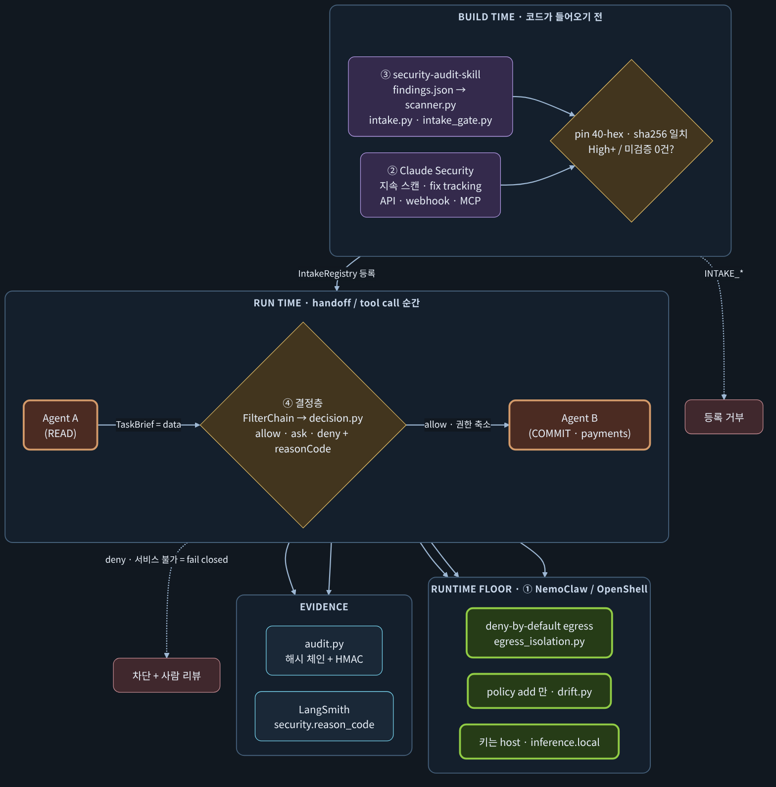

# Security Roadmap — Zero-Trust Agent Mesh (4영역 통합판)

> 목표: 멀티에이전트에서 **handoff 할 때 통제권을 잃지 않는다.** 모든 handoff · tool result · plugin · memory 는 신뢰 경계다.
> 그래서 "프롬프트를 더 잘 쓰기"가 아니라, 결정론적 코드가 경계마다 **allow · ask · deny** 를 내리고 그 근거(reasonCode)를 남긴다.
>
> 이 문서는 **숙제(`HOMEWORK_SECURITY.md`, 브랜치 `05-homework-security`)** 의 결과와 **4개 보안 도구 영역**을 하나로 묶은 기준 문서다.
> 기준일 2026-11-23 · 브랜치 `21-security-decision-layer`
>
> 상태 표기: ✅ main 에 구현·테스트 · 🆕 이 브랜치(21)에서 구현·테스트 · 🔀 구현됐지만 **미병합 브랜치**에만 있음(번호) · ⬜ 예정 · `[VERIFY]` 실물 확인 전

## 0. 한눈에 — 4영역과 이 저장소 코드

| # | 영역 | 지키는 경계 | 시점 | 이 저장소에서 맡는 코드 |
|---|---|---|---|---|
| ① | **NemoClaw** (NVIDIA, OpenShell 샌드박스) | 실행 환경 — 네트워크·파일·자격증명·추론 | Run time 바닥층 | `orchestra/sandbox/nemoclaw/{runner,drift,policy}.py`, `scripts/gen_nemoclaw_presets.py`, `nemoclaw/presets/`, 🆕 `orchestra/security/egress_isolation.py` |
| ② | **Claude Security** (Anthropic) | 우리 코드 — 지속 스캔·수정 추적 | Build time (상시) | `orchestra/security/scanner.py`(`SecurityScanner` 계약), `.github/workflows/security.yml`, `scripts/security_gate.py` |
| ③ | **security-audit-skill** (`ai-agent-orchestrator/security-audit-skill`) | 들여올 코드 — 플러그인·스킬·MCP | Build time (인입 시) | `scanner.from_audit_json`, 🆕 `orchestra/security/intake.py`, 🆕 `scripts/intake_gate.py` |
| ④ | **ai-security-architecture** (`ai-agent-orchestrator/ai-security-architecture`) | 메시지·결정 — handoff, tool call, 응답 | Run time 결정층 | `orchestra/filters/*`, `filters/tool_wrapper.py`, `hitl.py`, `security/{audit,invariants}.py`, 🆕 `orchestra/security/decision.py` |

**한 줄 요약**: ③·② 가 "무엇이 들어올 수 있나"를, ④ 가 "들어온 것이 무엇을 할 수 있나"를, ① 이 "그래도 뚫렸을 때 어디까지 나갈 수 있나"를 정한다. 모든 결정은 같은 reasonCode 로 감사 로그와 LangSmith 에 남는다.

---

## 1. 왜 멀티에이전트는 보안 모델이 달라야 하나 (위협 8가지)

| 위협 | 멀티에이전트에서의 양상 | 대응 | 영역 | 상태 |
|---|---|---|---|---|
| 간접 프롬프트 인젝션 | 웹/문서/툴 결과 안의 지시문이 handoff 를 타고 상위 에이전트까지 전파 | `request_gate`, 툴 결과=데이터, 출처 라벨(taint) | ④ | ✅ 게이트·레드팀 / 🔀 taint 격리(17) |
| 권한 상승 / confused deputy | 약한 에이전트가 결제 에이전트에게 "대신 해줘" | 금액은 서버가 hold 합계로 계산, 위임 시 권한 축소 | ④ | ✅ 서버 계산 / 🔀 capability 축소(16) |
| 과도한 대리 행위 | 승인 없이 결제·삭제·전송 | 부작용 등급 + COMMIT 마지막 방어선 + HITL | ④ | ✅ |
| 데이터 유출 | 허용된 경로로 PII 를 외부로 | deny-by-default egress, PII 마스킹, 샌드박스별 host 분리, **반복 거부 시 자동 격리** | ①④ | ✅ / 🆕 격리 |
| 공급망 | 플러그인/MCP/스킬이 악성·변조 | **SHA 고정 + 해시 + 스캔 → 통과분만 등록** | ③② | 🔀 벤더링 LOCK(08) / 🆕 인입 게이트 |
| 상태/메모리 오염 | 체크포인트·장기 메모리에 심은 지시문 | 저장 전 필터, 출처 라벨, TTL | ④ | 🔀 일부(17, 19) / ⬜ |
| 폭주 / 비용 공격 | 무한 handoff, 토큰 소진 | recursion_limit → 중단 결과, budget, 서킷브레이커 | ④① | ✅ / ⬜ 서킷브레이커 |
| 부인 / 추적 불가 | 누가 무엇을 근거로 승인했나 | 해시 체인 + HMAC 감사 로그, 승인 바인딩, **reasonCode** | ④ | ✅ 로그 / 🔀 바인딩(15) / 🆕 reasonCode |

## 2. 설계 원칙 (모든 영역 공통)

| # | 원칙 | 강제 지점 | 상태 |
|---|---|---|---|
| P1 | **LLM 은 정책 결정자가 아니다.** 허용/차단은 결정적 코드가 한다 | FilterChain, 🆕 `decision.FailClosedClient`(LLM 점수는 `signals` 참고값) | ✅ |
| P2 | **에이전트 간 메시지는 지시가 아니라 데이터다.** `TaskBrief`/`TeamReport` 는 스키마·크기 제한·출처 라벨 | `hierarchical_tools.py` | 🔀 14 |
| P3 | **권한은 위임할 때 줄어들기만 한다** (팀·에이전트 tools/domains/sandboxes ⊆ 부모) | `capabilities.py` | 🔀 16 |
| P4 | **승인은 행위에 묶인다**: `(tool, args 해시, 금액, 사용자, 만료)`, 1회용, 인자가 바뀌면 무효 | `hitl.ApprovalRecord`, `ApprovalLedger.claim` | ✅ 1회용 / 🔀 바인딩 15 |
| P5 | **실패는 닫는다**: 필터 예외·샌드박스 부재·무응답 승인·결정 서비스 불가 = 차단 | chain, tool_wrapper, 🆕 `FailClosedClient` | ✅ |
| P6 | **관측 가능해야 방어된다**: 모든 BLOCK·승인·egress 거부가 같은 reasonCode 로 로그·trace 에 | `audit.py`, 🆕 `Decision.trace_metadata()` | ✅ 로그 / 🆕 코드 / ⬜ LangSmith 연결 |
| P7 | **한 에이전트가 [민감 데이터 + 비신뢰 콘텐츠 + 외부 전송]을 동시에 갖지 않는다** | 에이전트당 툴 ≤3, 샌드박스별 egress | ✅ 구조 / ⬜ 자동 검사 |

## 3. 코드 라인 현황 — 먼저 읽을 것

`c9eb328` 에서 두 줄기로 갈라져 있다. **보안 로드맵의 런타임 결정층(P2·P3·P4)은 아직 main 에 없다.**

| 줄기 | 브랜치 | 들어 있는 것 |
|---|---|---|
| **main** (Claude, 숙제) | `05-homework-security` → `06-security-harness` → main(`37cd0af`) | R0~R4, O1~O4, eval 게이트, 폭주 방어, garak 계약 |
| **Codex 스택** (미병합) | `06-packaging` → … → `20-playground-trace-tabs` | C1~C15 + `14-message-contracts`, `15-approval-binding`, `16-capability-attenuation`, `17-input-normalization-taint`, `19-ledger-persistence` |
| **이 브랜치** | `21-security-decision-layer` (main 기준) | 🆕 결정 계약·reasonCode, egress 자동 격리, 플러그인 인입 게이트 |

🆕 세 모듈은 **새 파일만 추가**하고 `tool_wrapper.py`·`runtime.py` 를 건드리지 않는다. 그래서 Codex 스택과 충돌 없이 어느 쪽 위에도 올라간다.
**다음 결정(PM)**: Codex 스택을 main 에 병합할지, 병합 순서는 어떻게 할지. 병합 뒤에 🆕 모듈을 런타임에 연결한다(§8).

---

## 4. ① NemoClaw — 실행 환경 바닥층

**확인된 사실** (NVIDIA 문서 + 포크 소스, 상세는 [`NEMOCLAW_REALITY.md`](NEMOCLAW_REALITY.md))
- egress 는 **기본 거부**, 허용 목록에 없는 목적지는 OpenShell 이 가로채 운영자가 TUI 로 승인/거부한다. 엔드포인트 규칙은 바이너리 단위이고, 허용 목록이 있어도 SSRF(내부 주소) 가드는 꺼지지 않는다.
- 자격증명은 host 에 두고 샌드박스는 `inference.local` 만 쓴다.
- 정책 변경 경로가 셋이고 성격이 다르다:
  - `policy add`(병합, 기록됨 → rebuild/restore 때 재생)
  - `openshell policy set`(**전체 교체**, 일부만 넣으면 나머지 preset 이 조용히 사라짐)
  - TUI 즉석 승인(실행 중 정책은 바뀌지만 **재생 가능한 preset 기록이 남지 않음** → drift 의 1순위 원인)
- `[VERIFY]` 명령 철자: 포크(alpha `ccf8e4e`) 소스는 `nemoclaw <sb> policy add`(공백), 최신 NVIDIA OpenClaw 문서는 `policy-add`(하이픈). 러너는 `CommandTemplates` 로 분리돼 있어 설치 버전에 맞춰 템플릿만 바꾼다.

| ID | 항목 | 구현 | 상태 |
|---|---|---|---|
| NS1 | 정책 drift 점검: 적용 preset ≠ 선언이면 기동 실패 | `sandbox/nemoclaw/drift.py`, `gen_nemoclaw_presets.py --check`(CI) | ✅ 기동 시 / ⬜ 주기 점검 |
| NS2 | 위험등급별 샌드박스 (read / payments / code), 샌드박스 간 같은 host:port 금지 | `ToolSpec.sandbox_name`, `policy.py` 검증 | ✅ 결제 분리 / ⬜ code 등급 |
| NS3 | 샌드박스 내부 이중 필터 | 워커 전송(N2) 필요 | ⬜ |
| NS4 | `inference.local` + 프라이버시 라우팅 | `models/factory.py` 라우팅 함수, 금지 호스트 목록 | ✅ 함수 / ⬜ 실모델 |
| **NS5** | **egress 거부 → 자동 격리 + 사람 리뷰** | 🆕 `security/egress_isolation.py` — `IsolatingSandboxRunner`(어떤 러너든 감싸는 데코레이터), 창(`window_s`) 안 거부 `threshold` 회 → 샌드박스 격리·내부 러너 호출 중단, 리뷰 큐, 해제는 사람 `by`+`reason` 필수, 이벤트를 감사 로그로 | 🆕 / ⬜ 런타임 연결 |
| NS6 | 변경은 `policy add` 만, 전체 교체 금지 | `runner.CommandTemplates` 에 `policy set` 템플릿 없음(테스트로 고정) | ✅ |
| NS7 | 시크릿 위생: 샌드박스에 장기 키 금지, IMDS 금지 | 금지 호스트 검증, 감사 로그 키는 host 에만 | ✅ 일부 |
| NS8 | 리소스 상한 | `budget`, recursion_limit→중단 결과, 러너 출력·시간 상한 | ✅ / ⬜ 서킷브레이커 |
| NS9 | 이미지 고정 + SBOM | — | ⬜ |

## 5. ② Claude Security — 우리 코드 지속 스캔

**확인된 사실**
- 2026-04-30 Claude Enterprise 대상 public beta (구 Claude Code Security). 레포·디렉터리·브랜치 단위 스캔, finding 마다 확신도·심각도·영향·재현 방법, **자동 적용 없음**(패치 제안만). CSV/Markdown 내보내기, webhook(Slack·Jira), dismiss 사유 기록.
- 2026-10 업데이트: baseline + 변경분 반복 스캔, 멀티 레포 프로젝트, 패치 반영 시 자동 fixed / 재발 시 reopen, 편집 가능한 threat model, 프로젝트 지식베이스, **API(토큰은 사용자 권한 상속)·webhook·MCP 커넥터·RBAC**.
- 공식 문서에 **PR 단위 머지 차단 기능은 없다** → PR 게이트는 Claude Code `/security-review` GitHub Action + 우리 `security_gate.py` 로 구성한다.
- Team/Max 는 "coming soon" → 우리 플랜이 Enterprise 가 아니면 ③ 경로만으로 운영한다.

| ID | 항목 | 구현 | 상태 |
|---|---|---|---|
| S1 | `SecurityScanner` 계약 + `FakeScanner`, 코어는 특정 제품 import 금지 | `security/scanner.py` | ✅ |
| S2 | PR 마다 CI 스캔, High+ 머지 차단 | `.github/workflows/security.yml` + `security_gate.py` | ✅ 게이트 / ⬜ Claude Security API 어댑터 |
| S4 | `security_lead` 팀 (scan/policy/redteam): **제안만**, 적용은 COMMIT 승인 | `domains/security/`, `orgs/security_review.yaml` | ✅ / ⬜ MCP 커넥터로 finding 읽기 |
| S5 | finding → 필터/preset 수정안 → `--check` → 사람 승인 → `policy add` | `scenarios/security_policy_change.yaml` | ✅ 시나리오 |
| S6 | finding·BLOCK·egress 거부 → LangSmith feedback / annotation queue | eval 모듈(무네트워크) 완료, 🆕 `Decision.trace_metadata()` | ✅ 일부 / ⬜ 업로드 경로 |
| CS-2 | 멀티 레포 프로젝트로 handoff 경로(오케스트레이터·플러그인 레포) 함께 스캔 | 제품 설정 | ⬜ |
| CS-3 | threat model·지식베이스에 P1~P7 과 "에이전트 메시지 = 비신뢰" 등록 | 제품 설정 | ⬜ |

## 6. ③ security-audit-skill — 외부 코드 인입 게이트

**확인된 사실**: `cloudflare/security-audit-skill`(MIT) 포크. 6단계(정찰 → coverage 기반 탐색 → 반증형 검증 → `findings.json` 스키마 검증 → 독립 재검증 → 보고). 판정 `confirmed`/`needs_validation`/`rejected`, 심각도는 confirmed 에만. 후보를 찾은 에이전트가 검증자가 되지 않는다. 대상 코드를 실행하려면 OS 수준 샌드박스가 필요하고, 없으면 `needs_validation` 으로 남는다.

| ID | 항목 | 구현 | 상태 |
|---|---|---|---|
| R3 | `findings.json` → `FindingsReport` 매핑 (위치·심각도 없는 confirmed 는 격하) | `scanner.from_audit_json` | ✅ |
| **S3 / SA-1** | **플러그인 인입 게이트**: ① 커밋 40-hex SHA ② 파일 sha256 일치·목록 외 파일·심볼릭 링크·경로 탈출 금지 ③ 스캔 차단 대상 0건(인입은 엄격 모드: `needs_validation` 도 차단, 스캐너 예외 = 차단) → 통과분만 `IntakeRegistry` 등록, 노출 시 `assert_exposable` 이 다이제스트 재대조 | 🆕 `security/intake.py`, 🆕 `scripts/intake_gate.py`(LOCK.json 을 플러그인 단위로 분할, findings 파일 없음 = 불합격) | 🆕 / ⬜ 카탈로그 연결 |
| SA-2 | 감사 대상 코드 실행은 NemoClaw `code` 등급 샌드박스에서만 | NS2 code 등급 필요 | ⬜ |
| S7 | 레드팀 회귀: 간접 인젝션·handoff 오염·도구 결과 위장·금액 조작·PII 유출·무한 handoff | `tests/test_redteam.py`, `invariants.py` 4종, `scenarios/redteam_*.yaml`, garak 브리지 | ✅ / ⚠️ garak probe 전체 실행 미검증 |

## 7. ④ ai-security-architecture — 런타임 결정층

**확인된 사실 (우리 저장소)**: Fixed Guard → Cost Control → Dynamic Metric Guard → NeMo Guardrails → Privacy Output Guard → Observability. 모든 결정에 reasonCode, 같은 코드를 응답·감사 로그·메트릭·대시보드에. 확장 설계(`docs/EXTENSION_DESIGN_NOTES.md`)는 가드를 런타임 밖에 두고 `allow | ask | deny + reasonCode` JSON 계약으로 호출, 서비스 불가 시 deny. README 상 확장부는 미구현.

| ID | 항목 | 구현 | 상태 |
|---|---|---|---|
| AR-1 | **결정 계약** `Decision{action: allow/ask/deny, reason_code, by, approval}` + `DecisionRequest`(args 는 해시, LLM 점수는 `signals`) | 🆕 `security/decision.py` | 🆕 |
| AR-1b | **fail-closed 클라이언트**: 예외·타임아웃 → `DECISION_SERVICE_UNAVAILABLE`, 계약 위반·모순 응답(allow + 차단 사유) → `DECISION_INVALID`, 관측 콜백 실패는 결정에 영향 없음 | 🆕 `FailClosedClient`, 로컬 체인을 서비스로 쓰는 `ChainDecisionClient` | 🆕 |
| AR-2 | 위임 권한 축소 검사 | 🔀 16 `capabilities.py` | 🔀 |
| AR-3 | 서명·바인딩 승인 `(tool, args_sha256, amount, user, exp)` | ✅ HMAC 감사 로그 / 🔀 15 바인딩 | 🔀 |
| AR-4 | 데이터/지시 분리: 하위 출력은 `data` 로만, 툴 결과 지시문 격리 | 🔀 14·17 | 🔀 |
| AR-5 | 세션·에이전트 위험 점수 (반복 deny → strict/blocked 프로필) | — | ⬜ |
| AR-6 | 해시 체인 감사 로그 (+HMAC, head 외부 보관으로 잘라내기 탐지) | `security/audit.py` | ✅ |
| **AR-7** | **reasonCode 레지스트리**: FilterChain 결과·`tool_wrapper` 오류 dict → 단일 코드(`BLOCKED_PROMPT_INJECTION`, `COMMIT_WITHOUT_APPROVAL`, `EGRESS_DENIED_ISOLATED`, `INTAKE_*` …), `trace_metadata()` 로 LangSmith metadata 키 `security.reason_code` | 🆕 `ReasonCode`, `from_chain_result`, `from_tool_output` | 🆕 |

## 8. 숙제(HOMEWORK_SECURITY) 결과 → 4영역 매핑

| 숙제 항목 | 결과 | 영역 |
|---|---|---|
| R0 환경 점검 | ✅ 문서·스키마·소스 기준 실측 (`NEMOCLAW_REALITY.md`) / ⚠️ 설치본 실출력 대조 남음 | ① |
| R1 실제 러너 | ✅ allowlist CLI 래퍼, `policy set` 템플릿 없음, 워커 전송(N2) 없으면 fail-closed | ① |
| R2 드리프트 점검 | ✅ 기동 시 불일치 = 기동 실패 | ① |
| R3 스캐너 인터페이스 | ✅ audit-skill 실제 스키마 반영 | ②③ |
| R4 레드팀 회귀 | ✅ 불변식 4종 + 공격 케이스 + garak 브리지 / ⚠️ garak 전체 실행 | ③④ |
| O1 security-guidance 흡수 | ✅ `code_guard` 필터 | ④ |
| O2 security_lead 팀 | ✅ 제안만, COMMIT 승인 | ② |
| O3 감사 로그 | ✅ 해시 체인 + HMAC | ④ |
| O4 CI 게이트 | ✅ 워크플로 + `security_gate.py` | ② |
| C11 일부(eval) · 폭주 방어 · garak 계약 | ✅ (상세는 `HOMEWORK_SECURITY.md` 진행 현황) | ②④ |
| **이번 추가 (21)** | 🆕 결정 계약·reasonCode(④), egress 자동 격리(①), 인입 게이트(③) — 테스트 44개 | ①③④ |

## 9. 다음 순서

1. **병합 결정 (PM)**: Codex 스택(06~20)을 main 에 병합. P2·P3·P4 가 여기서 main 에 들어온다.
2. **연결 (병합 직후)**:
   - `simulation.py`/`service.py` 에서 `rt.sandbox = IsolatingSandboxRunner(runner, guard)`, `guard.on_event` → `rt.events` + `AuditLog`.
   - `tool_wrapper` 의 차단 결과에 `from_tool_output(...).trace_metadata()` 를 붙여 LangSmith 로 (`safe_call` 경유).
   - 카탈로그(`orchestra/catalog`, 브랜치 10)가 플러그인을 노출하기 전에 `IntakeRegistry.assert_exposable` 호출 → 미등록 플러그인은 `ToolSpec` 으로 노출 불가.
   - CI 에 `scripts/intake_gate.py --lock third_party/LOCK.json …` 추가.
   - 시나리오 `sandbox_egress_isolated.yaml`(같은 샌드박스 egress 거부 3회 → 격리 → 리뷰 큐).
3. **실물 점검**: NemoClaw 설치본으로 `policy add` 철자·`policy get` 출력 대조, garak probe 전체 실행, 워커 전송(N2) → NS3.
4. **제품 연동**: Claude Security 플랜 확인 → API 어댑터(`SecurityScanner` 구현), threat model 에 P1~P7 등록.
5. **나머지**: AR-5 위험 점수, 서킷브레이커, NS9 SBOM, P7 자동 검사.

## 10. 하지 않는 것 / 한계

- Claude Security API·webhook 스키마, NemoClaw 설치본 실출력은 이 환경에서 확인하지 못했다. 모든 연동은 **인터페이스 중립 어댑터**로 둔다.
- 샌드박스 `binaries` 가 글롭이면 실행파일 단위가 아니라 **샌드박스 단위 격리**에 의존한다 → 결제 샌드박스엔 워커 외 코드를 두지 않는다. 같은 이유로 자동 격리도 샌드박스 단위다.
- 보안 에이전트는 **제안자**이지 결정자가 아니다. 정책 적용·결제·격리 해제는 항상 사람.
- 공격 도구 채택 금지: 승인된 대상 외 스캔·익스플로잇 코드는 넣지 않는다.
- 어떤 설계도 "최상"을 보장하지 않는다. 레드팀 회귀·불변식·감사 로그로 **측정하며 올린다.** 통제는 테스트나 측정으로 확인됐을 때만 ✅ 로 표시한다.

## 출처
- NemoClaw: [Overview](https://docs.nvidia.com/nemoclaw/latest/about/overview.html) · [Network Policies](https://docs.nvidia.com/nemoclaw/0.0.16/reference/network-policies.html) · [Security Best Practices](https://docs.nvidia.com/nemoclaw/latest/user-guide/openclaw/security/best-practices) · [Apply Policy Presets](https://docs.nvidia.com/nemoclaw/user-guide/openclaw/network-policy/configure-policies/apply-policy-presets) · 포크 [`ai-agent-orchestrator/NemoClaw`](https://github.com/ai-agent-orchestrator/NemoClaw)
- Claude Security: [public beta 발표](https://claude.com/blog/claude-security-public-beta) · [2026-10 업데이트(Help Net Security)](https://helpnetsecurity.com/2026/10/22/claude-security-continuous-scanning-update)
- [`ai-agent-orchestrator/security-audit-skill`](https://github.com/ai-agent-orchestrator/security-audit-skill) · [`ai-agent-orchestrator/ai-security-architecture`](https://github.com/ai-agent-orchestrator/ai-security-architecture)
